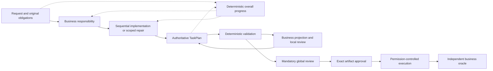

# Overall progress and functional responsibility — PR #120

The progress projection and generic regressions are implemented at frozen source
`ed9a3a3e570a9a9deec60693b9dc3912209e3aa6`. Live qualification remains **0/6**.
No fresh paid generation, artifact approval, business execution or oracle was
attempted for this source. PR #120 stays Draft.

## Implemented architecture

One format-11 TaskPlan remains authoritative; selection contract 2 and JavaScript
→ YAML v15 are unchanged. Both selection stages receive `overallProgress`, an
index derived from original obligations, accepted contributions, existing coverage,
reachability, completion assessment and review records. These facts are shared
within request preparation, without persistence, another traversal registry or an
additional model call.

The view links original results and constraints, accepted contributions, remaining
obligations, proven composition findings and missing required public bindings.
Declared outputs, producer lineage, structural reachability, business review and
observed execution remain separate. Uncertain lineage stays unverified; it is not
promoted to a violation or successful behavior. Planning explicitly reports
execution as unobserved. Required files and effects gain no invented public-export
requirement.

Existing original text and evidence remain canonical. Large indexes retain exact
totals and existing page links; optional navigation compacts first. The active
block's objective and criteria appear once. Its identity, ownership and criteria
survive discovery, helpers, cursor changes, scope boundaries, accepted fragments
and restarts. A demonstrated evidence-navigation gap was corrected in `ed9a3a3e`: progress
links are offered in the action schema and requested original declarations appear
in business context. Reading off-page evidence grants no binding authority. No block
lifecycle change was needed. Existing consumer associations, scoped authority and
selective review invalidation remain
in force; ambiguous arguments and producer choices remain model decisions.

## Validation and decomposition quality

- Owning Planning suite: **2,707 passed**, zero failures/skips/compiler diagnostics.
- Affected Agent.Server suites: **542 passed**, zero failures/skips/compiler diagnostics.
- Clean frozen full solution: **7,699 passed, 13 skipped**,
  all 33 assemblies, zero failures/compiler diagnostics, exit 0 and unchanged source.
  Command: `dotnet test GnOuGo.Agent.sln -m:1 -warnaserror -p:SkipModelMetadataGeneration=true`.
  The 13 existing skips are seven Windows PowerShell cases on macOS, one opt-in
  persisted-question browser smoke and five opt-in live Copilot/GitHub cases.
- All **11 publication stages passed**, including five packages, Planning Native
  AOT execution, trimmed Agent.Server publication, encrypted-storage and exact-receipt
  recovery. Matching benchmark/MCP builds and 24 synthetic artifact-review helper
  checks passed. Source remained unchanged; no new warning suppression was added.
  Existing documented trimming boundaries remain; Agent.Server is not claimed to
  be fully Native AOT. No package upload or deployment occurred.

Six paired capability/fragment fixtures use the same business request with coarse,
fine and differently grouped capabilities, and one-task versus larger fragments.
They preserve each scripted selection's responsibility across serialized restarts, then
perform **18 local fixture executions** with an independent arithmetic oracle,
exact operation order, cleanup and final-only public output checks. Global ordering,
privacy, cleanup and deliverable clauses remain in selection, drafting and review.
Different wording is allowed; these fixtures impose no universal block count and
do not measure autonomous live decomposition quality.

Ten projection regressions cover purity, deterministic serialization, no extra
model calls, exact issued-request/evidence recovery, usable declaration/page links,
missing invocation/result/export connections and restored connections. Existing same-block consumer/boundary,
selective repair, conditional, empty-loop, optional-group, local-file, optional-binding
and nullable-assertion regressions remain exercised. Ordinary input limits still
pass; diagnostic optimization targets remain advisory under captured policies.

The prior-source solution capture completed separately at
`de37711ffd5b9175982286a83cf1e8931ec79e85`: **7,683 passed, 13 skipped, all 33
assemblies, zero failures/compiler diagnostics**, exit 0 and unchanged source.
It is not attributed to this new production source. Earlier failed `1f801c40` and
`5656ccdd` captures and the incomplete historical `b50de043` capture remain retained.

The intermediate projection source `31c73c3cee09419605fc395f7ce3161ee888bc87`
also completed separately: **7,695 passed, 13 skipped, all 33 assemblies, zero
failures/compiler diagnostics**, exit 0 and unchanged source. The subsequently
demonstrated evidence-navigation gap and its four new regressions belong to
`ed9a3a3e`; this earlier pass is not relabeled as final-source validation.

## Live outcomes, identities and barriers

All new-source streaks are zero. No fresh dispatch is admitted. Existing profiles,
inputs, oracles and immutable GPT-6.1 campaign amendment are retained. Both
Collections runtime variants remain required per future qualifying generation.

The two earlier actual GPT-6.1 Amazon attempts remain separate:

| Run / source | Generation outcome | Logical / physical calls | Corrections / transport retries | Known input / output tokens | Reasoning within output | Planning duration | Known EUR cost |
| --- | --- | ---: | ---: | ---: | ---: | ---: | ---: |
| `g611f801c40amz32a-amazon-1` / `1f801c40` | Engine cleanup-export interface defect; repetition guard stopped three rejected caller selections | 14 / 14 | 3 / 0 | 61,355 / 9,839 | 5,619 | 738.337 s | 3.2307630378388049020484837641 |
| `g615656ccddamz32a-amazon-1` / `5656ccdd` | Provider/transport failure; usage unverifiable | 9 / 11 | 0 / 2 | 27,315 / 4,211 | 2,538 | 1,352.327 s | 1.4110653904642633509258430987 |

Neither reached global review, exact approval, execution or an independent live
oracle. The first reached one local Judge request, **21,485 complete serialized
host-request bytes**, with a maximum complete request of 62,829 bytes. The second
reached no Judge; its maximum complete request was 76,493 bytes. These are complete
host-request sizes, not prompt-only counts or HTTP wire measurements. Reasoning
tokens are already in output and are not added again. The generic engine defect
was corrected in `5656ccdd`; its failed run is preserved without continuation.

The second run exhausted its unchanged three-attempt policy after two HTTP 500
`ESG120` backend-unavailable responses and one transport failure. Three unknown
attempts retain **EUR 21.986841399051793541461669202**, with one unresolved request.
No provider probe, fallback, manual retry, replay, new administrative closure or
reservation release is authorized by the old closures.

Current strict read-only configuration checks also reject the effective host
fingerprint against the existing amendment, on both the new and retained old
binary. The configured model remains `OpenAi / gpt-6.1-sol-2026-09-29` and declared
metadata fingerprint remains
`d561ae7d28d9ffddf457937a878dbbe4ca4f70e0116a89b81842bdbb16da21e1`.
Unbound metadata readiness is not dispatch permission or backend availability.
No settings or immutable records were changed to clear this barrier.

Campaign amendment:
`9bcafa16e4cfa77599bd5757901d11c41a9578f9efc36600b90589a81c50d9dd`.
Established profile SHA-256 identities:

| Scenario | Profile SHA-256 |
| --- | --- |
| Amazon | `1ae308efc238e137e12e98db45e533b7d270abaa680650f9946aa31c32d20e4c` |
| Review PR | `00fcfe333c623720a4cd0495bb604d784c00e4229b6ba008cfebe357d1764c8e` |
| Collections | `0f8566ddb5f847a98fb5d91f3f5f9422c5d7ab047e8425dc954f43b65af12074` |

The refreshed ledger is unchanged: **EUR 413.98214989055111712576930921 known,
157.57430550399738390479699311 reserved, 168.47364843815780351187864498 available**,
under the unchanged EUR 740.0301038327063045424449473 ceiling. It retains 7,035
physical attempts, 160 unknown attempts, 63 permanent closures and one unresolved
request. The evidence fingerprint remains
`79ca579fe0431c32f7c489b6bd76c6e637d4f32b68a19a76bfd19bfae872f501`.
Available funds do not clear the configuration/provider/replay barriers.

No live convergence or cost saving is established. Historical GPT-5.5 comparisons
cannot isolate code improvements from the model switch. The unrelated solution-file
edit remains unchanged and excluded from the committed source freeze.

See [source-bound validation](overall-progress-ed9a3a3e-validation.json),
[retained provider failure](sequential-gpt61-5656ccdd-provider-stop.json),
[first actual GPT-6.1 failure](sequential-gpt61-1f801c40-amazon-failure.json) and
[convergence journal](compact-taskplan-convergence.md).
