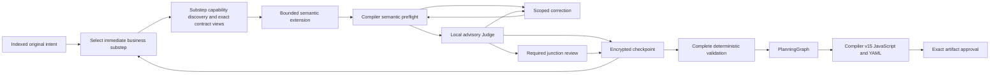

# Incremental TaskPlan construction

Fresh version-2 sessions extend one semantic TaskPlan from available producers
toward consumers. They index original intent once, select one immediate business
substep, discover its capabilities and generate only its fragment. Each bounded
draft passes deterministic semantic validation and a local advisory review before
acceptance. A simple workflow can finish in one draft after intent and substep
selection. There is no new executable representation or alternate engine.

## Durable boundaries

`PlanningSession.Plan` holds accepted semantic work. Optional versioned
`Construction` metadata records its frontier, candidate, checkpoint manifests,
requirement associations, review evidence and correction progress. Version 2 also
retains source coverage, the current substep, tentative commitment bindings,
selected contract views, requirement closure and issued-request measurements. These records
are non-executable and use the existing encrypted session, tenant, optimistic
revision and leases. Storage format 10 remains unchanged.

Extensions reuse task, value, group, choice and output contracts and append only
to issued open scopes. Apply candidates atomically to a clone. Compiler semantic
preflight remains the authority for types, contracts, ownership, references,
provenance, assertions, permissions and dependencies. Partial validation does not
lower a graph or suppress arbitrary final-validation errors.

Control inputs must be valid when a scope opens. Future work remains an obligation,
never a placeholder or dangling reference. Unfinished containers cannot supply
results, presence, ordering dependencies or callable group interfaces outside
their boundary. Child tasks may consume available values in their lexical scope.
Closing conditional branches requires compatible exports; parallel siblings
connect through enclosing exports.

Intent indexing processes stable original request and answer pages without
discarding source text. Page boundaries bound the bytes after both JSON escaping
layers and preserve Unicode characters. Fresh presentation protocol 2 prefers
natural text boundaries and links unavoidable continuations; a severed obligation
cannot become independently complete on either page. Classification retains exact
verbatim clauses and identifies interface-bearing passages. Only those passages
receive a subsequent typed-interface extraction request, within the same journaled
intent phase. Pending extraction blocks generation and completion. Prose-only
classification carries no recursive type/default grammar. Historical sessions
without the optional captured presentation version keep combined indexing and
their saved pages and schemas unchanged.
Requirements retain exact source references and applicable
global constraints. All source pages must be processed; a summary is never a
replacement for authoritative intent. Selecting a substep identifies its original
requirements, target scope, available input ports, expected outputs, dependencies
and permitted task kinds. Missing prerequisites remain frontier obligations, not
executable placeholders. Cleanup and scope/export closure are selectable substeps.
Selection distinguishes internal expected results from declared public workflow
outputs. Public names are presented eight at a time and constrain the issued
selection schema; omitted requirements, interfaces and outputs have explicit
page addresses. Internal task, group and child-export names do not become public
outputs merely by appearing in a substep description.
Required actions, setup, cleanup and results remain explicit completion
obligations. Action-specific constraints stay with their requirements; global
clauses describe crosscutting invariants. Indexing does not reconstruct effect
payloads or resource schemas as public workflow interfaces.
Selection keeps the earliest unresolved original requirement as its anchor.
Retrieve prerequisite clauses one per supplemental page with explicit next
addresses, without surveying future work or replacing that anchor. Render each exact
requested page once. Navigation descriptions and port-name directories are
bounded and identify omitted material through versioned retrieval addresses;
complete original requirements and required type constraints are never cropped.
An unspecified array cardinality remains null: zero is an actual bound.
Task navigation presents four tasks per page and eight port names per task,
including declared results of closed group calls. Original objective and port
pages carry version hashes; rebuilding the same task identity cannot silently
resolve an older page address to changed evidence.

Each phase receives only the context needed for that substep. Discovery uses its
needs rather than the global request. Previously inspected operations remain in
encrypted storage but do not become mandatory context in later calls. Discovery
descriptors identify exact contracts and retrieval addresses. Original contracts
remain unchanged; selected schema views retain relevant ancestors, required
siblings, cross-field constraints, alternatives and reference closure. Descriptors
cannot authorize execution or replace a contract. Separable original evidence can
be paged; indivisible required information that exceeds the phase allowance stops
explicitly. No unused request capacity is filled with unrelated suggestions.
Discovery directories present two operation descriptors or two sources at a time.
Provider metadata actions are presented separately in pages of two exact source
and continuation pairs. Their versioned evidence addresses are local navigation,
never provider cursors. The issued schema fixes each source/cursor pair and uses
`query:null`; the host supplies the selected substep objective. Exhausted or
unavailable providers remain explicit and cannot be fetched repeatedly. Discovery
retains applicable original global constraints. After bounded inspection, an
unsuitable tentative operation selection can be replaced within the same scope
and requirements, consuming one captured correction and retaining its evidence.
This does not widen explicit revision authority or authorize substitute effects.
Once operation descriptors are available, source metadata remains available through
its directory address instead of being repeated beside every operation page.
Output-port directories preserve original producer business-port mappings, including
aliases beyond the first page; their addresses are distinct from wire-schema paths.
Schema evidence retrieves the selected original subtree and its coupled constraints.
Nested directories expose child-directory addresses, allowing navigation without
retrieving a large parent subtree. Required-sibling context uses the same
constraint-preserving projection as other input views, with exact addresses for
independent optional descendants omitted from presentation. Coupled constraints
and their reference closure remain indivisible. Judge navigation prose is bounded
by escaped bytes, and proposed public-result commitments name only outputs selected
for the current substep under the fresh presentation protocol.

A call substep selects one closed reusable group with `groupId`. Its draft and
Judge context includes the immutable group hash and exact input/output interface,
including input defaults, without copying the body. `group:<id>` retrieves that
interface. Open groups expose no consumable outputs and cannot be selected for calls.
Version-2 checkpoints retain the selected substep and introduced group identities.
Later group-body steps retrieve that opening intent and its expected results
without copying the group's tasks or unrelated checkpoint history. Invalidated
opening metadata does not supply current scope intent.

Within a selected scope, `scopeInterface` presents existing export declarations
without making an open container consumable. Generation adds only new exports;
an empty extension output list preserves accepted ones. Closure review receives
the applied candidate's exports and their compiler-derived types, labeled
tentative. These views contain eight exports per page with hash-bound continuation
addresses, and omit task bodies and unrelated scopes. A transform's required
object result type declares named output ports: a reference to a named field
consumes that field's type, while an unqualified reference consumes the object.

Intent, selection, discovery and evidence response schemas contain no TaskPlan
grammar. Generation schemas expose only selected task kinds and operation IDs;
container openings establish empty child scopes for later substeps. Compiler
validation still uses complete original contracts. Compact schemas retain the
selected kind's necessary semantics, including scoped exports, ordered loop
results and the distinction between total iteration ceilings and concurrency.
The issued schema permits scope closure and workflow completion only when the
known frontier and original requirement statuses permit them. A sufficient leaf
fragment can still finish in one draft; opening an empty container cannot finish
the workflow. Complete semantic validation remains authoritative after generation.
Draft and Judge context omit
unrelated history, contracts, interfaces and requirement pages. Already issued
requests and saved review contexts retain their exact bytes and hashes.

Historical version-1 construction retains its captured whole-contract optional
admission and inspection semantics. New presentation rules never reinterpret a
saved version-1 request or receipt.

## Review, correction and finalization

Every candidate requires local review before acceptance. Intermediate reviews
inspect multi-fragment closures, joins and every four accepted drafts, coalescing
overlapping triggers. Locations and evidence must resolve to supplied originals.
Invalid reports leave candidates unaccepted. Valid uncertainty stays unverified;
Judge findings are neither authorization nor deterministic proof.
Compact reviews include bounded host facts identifying scope openings, closures
and completion claims. An intentionally empty opening is assessed as an opening;
closing a scope or requirement still requires its complete work and exports.
Finding locations and evidence contain exact JSON Pointers without annotations;
explanations belong in their separate fields. Exact context lookup remains the
authority for accepting a reference.

Each Judge response selects one action. A completed review returns a findings
array (empty when no grounded finding exists) and null evidence requests. An
evidence action returns non-empty evidence requests and null findings. Both
fields null, or both arrays, remain inconclusive; an uncertainty statement alone
does not select an action. Already issued requests retain their original prompt,
schema and identity during recovery.

Corrections share the existing call, token, cost and time journal and require a
replacement review. A missing committed producer requires bounded replacement
of the tentative extension; an output-only typed patch cannot add that producer.
This routing never replaces an issued request or expands explicit edit authority.
Repeated candidates, exhausted allowances or an unprovable
preservation boundary stop construction. Earlier changes invalidate dependents
through data/order edges, captures, exports, control ownership, group calls,
contracts and cleanup. Independent fragments and accepted intent remain unchanged;
invalidated originals remain evidence.
Invalidation events append the reason, before/after hashes, original tasks and
scope ordering. Rebuilt tasks retain their lexical scope, normal/cleanup phase
and relative position among independent tasks. A second invalidation cannot
overwrite an unresolved rebuild.

Finalization requires closed scopes/dependencies and explicit requirement statuses.
Full TaskPlan validation, PlanningGraph checks, confirmation guards, compiler v15
and runtime validation remain unchanged. There is no final whole-workflow LLM
Judge. Compilation does not prove content accuracy or successful effects.

Version 2 separates requirement contribution from closure. A fragment may make
progress without satisfying a whole requirement. An explicit closure identifies
the exact original clause and relevant checkpoint evidence for scoped review;
coincident fragment/closure reviews are coalesced. New operation/result commitments
remain tentative with the candidate and append atomically when it is accepted.
Rejecting a candidate does not freeze its tentative operation choice. Previously
accepted commitments remain immutable. Closing a requirement records reviewed
declared coverage, never proof of prose completeness or successful execution.
The checkpoint retains which requirements the scoped review explicitly closed;
ordinary contribution checkpoints do not establish closure. A selected closure
may review an outstanding requirement without changing the TaskPlan or closing
its scope. It must close a previously unresolved obligation; repeating an already
closed requirement does not count as progress. A diagnosed tentative
step may request reselection within its original scope and requirement identities,
retaining rejected evidence and correction accounting. This cannot expand explicit
typed revision paths or change accepted fragments.
Navigation-cycle detection recognizes accepted coverage checkpoints and newly
indexed original sources even when the TaskPlan hash stays unchanged. Changing a
cursor, diagnostic, attempt count or remaining allowance is not progress. Retained
historical cycle identities continue to block their repeated actions.

## Captured capacity

Select `construction_preset: large` on a new `workflow.plan`, or
`constructionPreset: "large"` in a Designer start API request. Host setting
`TypedWorkflowPlanning.ConstructionPreset` controls the creation default.

| Limit | Ordinary | Large |
| --- | ---: | ---: |
| Model calls | 64 | 384 |
| Cumulative corrections | 4 | 64 |
| Recursive tasks per draft | 8 | 8 |
| Corrections per draft | 3 | 3 |
| Accepted checkpoints | 128 | 128 |
| Total generated nodes | 300 | 5,000 |
| Nodes per workflow | 300 | 5,000 |
| Generated workflows | 100 | 1,024 |

Host overrides are `LargeMaxModelCalls`, `LargeMaxReplanAttempts`,
`LargeMaxStepsTotal`, `LargeMaxStepsPerWorkflow` and `LargeMaxWorkflows`.
Effective limits are captured before dispatch. Recovery intersects saved call and
token allowances with current host ceilings; changed graph policy requires renewed
validation and review. Monetary and active-time limits remain captured in the
session. Large sessions are not accidentally capped by ordinary call settings.
No recovery operation silently increases captured limits.

The host retains 15,000,000 cumulative tokens and five hours of active time.
Version 2 captures hard admission ceilings measured by conservative complete-request
input-token estimates: 3,000 for intent
indexing, selection and discovery, 8,000 for generation/correction, and 4,000 for
local/intermediate Judges. Tighter host/request allowances still prevail. These
include instructions, original source excerpts, interfaces, response schema and serialization envelope;
there is no fallback to 32,000. Historical sessions retain their captured limits,
including the previous ordinary 12-call default.
Host settings `SelectionInputTokens`, `DraftInputTokens` and `ReviewInputTokens`
may tighten these phase ceilings for new sessions. The explicit large preset uses
the same compact input ceilings while retaining its larger call and graph capacity.

Captured output reservations remain 8,192 for non-Judge construction calls and
2,048 for Judges, bounded by generation settings. Eight tasks do not prove that
variable-sized content fits; oversized requests/responses fail explicitly.
`DraftOutputTokens` and `ReviewOutputTokens` configure those captured host
reservations. Authored `workflow.plan` generators use `draft_output_tokens` and
`review_output_tokens`; neither option raises the aggregate output ceiling.

Each constructed request, including a locally rejected request, retains its phase,
request and response-schema hashes and component measurements. Substep, accepted
baseline hash and selected contract identities/versions are recorded when applicable. Component UTF-8 byte counts reconcile with
the exact complete serialized Core `LLMRequest`. The versioned conservative input estimate
includes envelope overhead; component estimates are not billed usage. Provider
input, output and reasoning tokens remain whole-call measurements, with Judge as
a phase dimension. Reports expose safe identities and sizes, not private intent,
contracts or receipts. Transient presentation and measurement metadata never
participate in artifact identity; captured construction version/settings do.

Before selection or discovery as well as generation/correction dispatch, admission
checks unavoidable downstream generation and reviews against the existing call, token and monetary ledgers,
including parent budgets. Durable model journals expose their owned budget through
the provider-neutral construction admission interface; ordinary runtimes use the
execution context's budget. Currency estimates use the existing validated exchange
quotes. This check consumes no calls, tokens, money or receipts, and does not pin a
new exchange quote. It is not a reservation: each actual dispatch still requires
normal admission and durable accounting. Unknown pricing fails closed when a
financial limit is configured.

Nullable `PlanningPolicy.MaxStepsPerWorkflow` and `MaxWorkflows` retain historical
300/100 behavior when absent. `MaxStepsTotal` controls total graph size. Inherited
host policy remains authoritative over authored limits. Planning capacity never
enlarges execution steps, depth, loops, sandbox or parallelism allowances. Large
tests use broad graphs with shallow scopes.

## Compatibility and isolated evaluation

Fresh creation captures construction behavior. Historical sessions retain issued
schemas, compiler profiles, identities, approvals, receipts and cumulative usage.
Their required compatibility paths cannot be selected by new sessions. Legacy
Judge options do not disable local review. Pending calls resume the exact saved
request and consume a saved receipt once; uncertain completion blocks replay.

`workflow.plan` atomically retains a versioned creation checkpoint alongside each
new encrypted authored definition, outside authored options. An interruption before
the first session write recovers those exact construction limits and compiler
profiles. Historical definitions without that marker retain their original path;
new caller defaults cannot migrate them or replenish their allowances.

An explicitly delegated benchmark reviewer uses trusted host authority and
artifact-bound evidence. It records delegated provenance, never fabricated human
review. Production entrypoints cannot enable that authority or import its
approval. Runtime confirmations cover one exact in-scope invocation, never blanket
permission. Independent business oracles remain separate from review and authority.

Campaigns retain their encrypted ledger, uncertain reservations and identities.
Budget extensions append authorization history. Frozen cohorts retain source,
contract, settings and oracle hashes, including failures. Reports distinguish
compilation, declared coverage, business success, uncertainty, physical calls,
tokens, elapsed time and cost.
