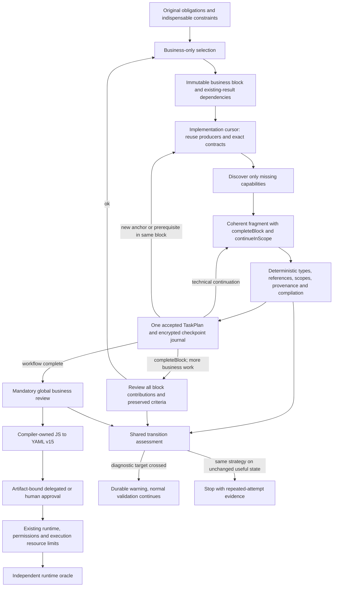

# Incremental TaskPlan construction

Repair progress compares a cited consumer with its exact retained review. A changed
upstream argument, value or executable transform instruction can change the meaning
of an otherwise unchanged consumer. The existing dependency-invalidation closure
then requires renewed business review rather than rejecting that repair as unchanged.
This establishes neither defect resolution nor wider edit authority. Cosmetic or
unrelated changes, missing or mismatched review context, and repeated ineffective
patches do not supply that progress.

Array type bounds remain literal constraints: a null maximum is unspecified;
zero permits no elements. The shared model grammar explains this distinction.
Both values remain legal, with no automatic bound adjustment or change to the
separate control/runtime capacities.

The planner constructs one authoritative semantic TaskPlan in bounded fragments.
The compiler lowers it through PlanningGraph and JavaScript to YAML v15. Construction
metadata is a non-executable journal, never another workflow or scheduler.



The diagram shows authority boundaries, not a second scheduler. Technical compilation
also runs before review; approval applies only to the final validated artifact.

## One active protocol

Internal planning format **11** replaces format 10 and all presentation revisions.
The host rejects retired sessions before deserialization, without rewriting records,
upgrading approvals or resuming old requests. Create and approve a fresh session.
Execution journals remain schema 9; TaskPlan semantics and compiler v15 are unchanged.
Historical reports, encrypted records, financial reservations and permanent request
closures remain audit data, without an executable compatibility reader. Fresh sessions
capture `business_selection_contract: "1"` within format 11. A retained session without
this exact selection contract is rejected before cloning, checkpointing or recovery.
The host never infers business blocks from historical technical steps or rebuilds an
old issued request with the new schema.

## Build from accepted work

Retain the complete original request and answers, source coverage, typed public
interfaces and original MCP contracts. Source indexing never replaces authoritative
text. Resolve neighboring naming/type clauses before asking for missing business facts.
Artifacts and file contents are not automatically public return values.

Short requests are understood in one intent call: exact clauses and their typed
caller/public declarations are validated together on a clone and committed atomically.
There is no provisional classification queue or mandatory second extraction call.
Each clause retains its declaration lists; empty lists mean no public interface,
while its business obligation remains. The shared compiler checks types and defaults.

Source boundaries follow measurement of the complete initial request, including its
schema, envelope and prospective evidence directory. Keep a whole original when it
fits the captured navigation presentation allowance; crossing the target alone does
not cause another call. Large sources use natural boundaries and exact continuations.
Short originals accompany subsequent decisions and relevant reviews once, without
repeating their text in source metadata. Larger originals retain local projection,
global constraints and exact retrieval. Capability filtering is independent.

Business selection has one strict business object; evidence retrieval and clarification
are separate, mutually exclusive actions:

```typescript
type BusinessBlock = {
  objective: string;
  requirementIds: OriginalObligationReference[];
  informationNeeds: string[];
  expectedResults: string[];
  dependencies: { resultId: ExistingResultReference; reason: string }[];
  successCriteria: string[];
};
type SelectionResponse = {
  block: BusinessBlock | null;
  evidenceRequests: OfferedEvidenceReference[] | null;
  clarifications: BusinessQuestion[] | null;
}; // Exactly one non-null action.
```

The context contains relevant originals, indispensable global constraints, remaining
obligations, established feasibility evidence and available planned business results.
Planned results are never runtime observations. References identify existing work;
there is no future-block executable graph. Kinds, scopes, MCP identifiers, typed
bindings, container transitions and fragment budgets belong to implementation and
never enter business selection. Recorded unavailable or unfinished discovery checks
appear only as plain feasibility observations: they do not establish that a capability
exists or is absent. Raw provider errors and model-authored rejected strategies are not
promoted into business facts. Original clarification answers retain their own authority.

The separate `construction_implementation` response uses `baseHash` and exactly one
of `step`, `evidenceRequests`, or `clarifications`. Its state-dependent `step` grammar
contains `scope`, `kind`, `operationIds`, `inputs`, `groupId`, `dependencyTaskIds`,
`closeScopes`, `closeRequirementIds`, `outputNames`, and `prerequisites`. Exact offered
scopes, retained contracts, accepted producers and closed groups constrain those fields.
The host copies `objective`, `requirementIds` and `expectedOutputs` from the immutable
block; the implementation response cannot redefine them. Unavailable actions are null.
[ImplementationSchema](../src/GnOuGo.Flow.Planning/PlanningCompactConstruction.cs)
constructs the exact issued grammar, including conditional branches and bindings.

The fragment response uses `extension` with required `completeBlock` and nullable
`continueInScope`, plus the available evidence/clarification/reselection action. Its
technical scope and unavailable/default-only fields are omitted by
[DraftSchema](../src/GnOuGo.Flow.Planning/PlanningCompactConstruction.Schemas.cs),
then supplied from the retained cursor. Literal values, actual tasks, exports, cleanup
and semantic choices retain their full typed grammar. `complete`, when available,
claims workflow completion separately from `completeBlock`.

Immutable block metadata and an active block ID retain the business responsibility.
`CurrentStep` is the implementation cursor: `Step.Id` owns its technical anchor and
reuse; `BlockId` groups contributions, preserved criteria, review and business completion.
Discovery, mappings, prerequisite suspension, repairs and scope changes preserve that
block. Implementation first reuses exact retained contracts and suitable accepted
producers, including pending-review outputs whose scope and provenance remain valid.
Related transforms, explicitly bound operations and populated controls share a fragment.
Necessary controls and groups may contain their body, exports and cleanup immediately.
Their nested scopes may combine sequence, conditional, foreach and parallel controls;
the selected anchor still constrains the top-level fragment, and every descendant
counts toward the same recursive task allowance.
Newly supplied complete control/group bodies close mechanically before checking
same-fragment consumers, including intentionally empty optional branches. The host
records those derived closures without changing the received response. An explicit
`continueInScope` retains that boundary and its ancestors; evidenced empty prerequisite
openings and their ancestors also remain open. Existing boundaries and the workflow
root still require their ordinary explicit closure authority.
An empty-only opening requires a current evidence-linked unresolved prerequisite,
or a still-current waiting prerequisite for the same original responsibility.
Use accepted producers and exact available results. Reuse known authorized contracts
and deterministic pagination/cache reads.
Cached operation identities, original descriptions and exact links remain visible after
accepting a checkpoint and selecting a different objective. Provider results remain
bound to their own query; cached metadata does not establish query completeness,
resolve a contract or authorize execution.
Discover unknown capabilities for that action before fixing its implementation.
Discovery includes the actual owning control or reusable group's isolated interface
and retained opening intent, as drafting does. An open declaration remains unreviewed
navigation; its exports are not consumable results and root inputs gain no group access.
Operation metadata describes contracts, not executed producer results. Existing eligible
interpretation can derive typed data from supplied inputs without another utility MCP;
missing external facts require authorized observation, preserving original permissions.
A group declares reusable inputs/body/exports; a call invokes it. An inline loop body
is not a reusable declaration. Preserve consumers waiting for exact prerequisites.
Their continuation presents the exact bounded reason from its own rejected step
through implementation discovery, retaining the evidence link. This model-authored
explanation does not create an original obligation or authorize effects or repair.

The recursive task target counts controls and all nested bodies and cleanup once.
Ordinary sessions enforce their captured eight-task default. New trusted diagnostic
sessions omit optimization-only `maxItems` and retain complete larger contributions;
10- and 25-task fragments undergo the same schema, repair, compilation and restart checks.
Genuine contract cardinalities, expression arities and explicit execution limits remain
hard constraints. Separate per-operation optimization bounds do not replace this policy.

Fresh fragment responses require `completeBlock`. `completeBlock:false` retains the
business responsibility even when `continueInScope:null`: technical closure exposes
valid outputs but supplies no business approval. A non-null `continueInScope` retains
the same technical cursor and refreshes bindings against accepted work before drafting
again. Null permits another implementation anchor inside the same business block.
`completeBlock:true` requests review of all relevant contributions under the preserved
criteria. It cannot simultaneously request technical continuation. Only a successful
business review completes a block. Workflow `complete` remains separate and requires
mandatory global review, which absorbs coincident final local review. Partial work
cannot close original obligations or discharge suspended business consumers.
Continuation probes use a cloned session with the same exact resolved-contract
admission as ordinary candidate validation. Missing or ambiguous contracts remain
invalid. Compiler failures retain their original task diagnostics instead of being
misreported as unavailable selected inputs when interface capture is suppressed.
Selected operations and expected outputs describe the whole block. A useful partial
prefix may contribute a subset, with the required cleanup; full selected-operation
coverage is checked across accepted fragments when the block finishes. A fresh draft
does not present the synthesized all-operations-per-requirement list as fragment
commitments. Explicit result bindings, actual candidate commitments and original
requirement commitments remain visible. Remaining obligations and accepted producers
come from the existing requirement and binding views; operation presence establishes
neither the required number of calls nor business completion.
A final fragment may only finish that retained block without adding another task;
this permission requires its accepted continuation checkpoint and grants no progress
credit or original requirement closure by itself.
Finishing a productive block requires local review before another business block,
including a single-fragment block that leaves its original obligation open; eligible
finalization still combines that work into the mandatory global review.
Open containers have no consumable
completion or outputs. Concrete references resolve immediately; future obligations
remain non-executable metadata. Apply candidates to clones, then run the compiler's
semantic preflight against original contracts, permissions and provenance. Invalid
candidates never replace accepted state. Checkpointing establishes technical acceptance,
not business fulfillment. Unreviewed completion claims stay in checkpoint metadata;
their original obligations remain selectable until an applicable successful business
review closes them. Retained claims may propose final review without establishing
fulfillment. Host-prepared closure reissues the full claim set, including sets larger
than a model selection page; unchanged claim repetition is not progress. A successful
completed-workflow global review closes every original obligation, including retained
claims outside the final step. Local review closes only its explicit current claims.

One selected discovery action follows exact provider cursors in host batches of four
reads, retaining the action across checkpoints instead of requesting another model
decision for pagination. Cycles, unavailable providers, caller cancellation and actual
provider/request resource limits remain enforced. The host's 1,024-page count is an
optimization target: ordinary sessions stop with the exact pending cursor retained;
fresh diagnostic sessions warn and continue. It is not a physical provider limit.
The ordinary two-request response target and four-request host admission bound are
also advisory for fresh diagnostics. Distinct source/cursor identities, exact query
ownership and completeness checks remain unchanged. Host batches of four are lossless
checkpoint scheduling, not a limit on the complete discovery action.

Typed `string_operation` values provide deterministic mappings: `text: "concat"`
accepts two through sixteen non-nullable string items; `text: "uri_component"`
accepts exactly one. Nested values use the ordinary typed binding grammar. The compiler
places their JavaScript expression at the consumer, without a runtime model/MCP call.
Computed text carries no artifact provenance, even when it equals a producer path.

An explicitly selected consumer binding may use an exact technically accepted
prerequisite while business review is pending. Ownership, transitive content,
scope, contracts and typed accessibility still validate; its composition remains
part of the pending business work. Automatic resumption requires an applicable
reviewed association or an explicit technically accepted association in the same
active block. The latter retains the exact accepted claims, complete consumer snapshot
membership, ownership chain, bindings and current producer content. Its `implemented`
consumer status exposes technical progress while the business responsibility remains
pending. Successful block review promotes the covered consumers to completion.
Cross-block resumption still requires reviewed authority; content freshness alone
creates no review authority.

Open-frontier pages order actual owning boundaries before their parents, including isolated group bodies. Canonical task addresses are flat identities, so their slash count does not establish ancestry. Acceptance and rollback use the existing symbols; paging retains exact continuation links.

Implementation selection requests the next executable contribution inside an offered scope. Attaching an original clause does not require completing that whole clause in one substep; a producer or prerequisite may contribute while its obligation remains open. Business selection retains its separate, implementation-free context.

Local requests derive their originals before packing: selected obligations, consumed
producers and their accepted requirement associations, ancestor controls/groups,
completion claims, explicit evidence and retained repair witnesses. Linked interface
and source clauses stay complete; indexed global constraints remain visible. Scope-page
cursors reset when a checkpoint replaces the accepted frontier and clears its evidence,
so earlier waiting consumers remain reachable. Selection
offers bounded remaining work with exact continuation links. Unrelated originals stay
retrievable. The final global review still receives every original obligation.
During drafting and correction, actual consumed interfaces retain the original producer
arguments and required contract closures. Prior checkpoint rows can therefore use their
existing exact evidence links; selection and discovery retain their progression facts.
Byte-identical fields of the same exact contract may share an earlier displayed view.
The original contract, its coordinates and differing schema branches remain intact.
Accepted scope-export evidence can be read through its exact link before selecting
that scope. It validates at the requested scope’s own frontier and grants no import
or result visibility. Tentative candidate pages retain their selected-scope and
clean-closure guards.

Selection, discovery, drafting and correction compact optional navigation toward their
captured targets. A selected operation and a producer sharing the same exact contract share
one directory anchor; fitting that anchor retains every consumed port and complete
schema view. Continuations use the first omitted original coordinate. Explicitly
retrieved evidence, producer arguments and mandatory constraints remain unchanged.
Omitted optional inputs retain bounded original-pointer/retrieval-ID rows; inspecting
another branch does not erase them or authorize the omitted input. Larger directories
remain reachable through their existing exact continuation links.
If mandatory context exceeds an ordinary profile's enforced input limit, construction
stops before dispatch. A captured advisory token or diagnostic policy retains that
context and warns; actual provider capabilities and financial admission still apply.

## Generation and judgment have different boundaries

An explicit repair retains only established requirement-completion claims. Editing
an intermediate producer does not claim that the remaining business workflow is done.
Selection distinguishes an unverified retained completion claim from a new closure
opportunity, using the existing host check for both its response choices and scope
closure presentation. Pending claims still require business review.
The draft schema also removes deferred claims for boundaries that its selected
closure necessarily closes. Existing exports are preserved; new exports use the
ordinary extension. Legal ancestor claims keep their validation and required review.

Several generated fragments may form one coherent business block. Empty openings,
unused group declarations and exact mechanical exports/closures do not independently
trigger a Judge. Review completed business blocks when construction continues beyond
them, including their actual consumers, ancestor controls and effects.
The projection retains actual ancestor scope states, including an open root, and
their existing finalization actions and dependencies. A child boundary's closure
does not claim completion of its ancestors or outstanding global obligations.

Contract-declared artifact arguments expose reference choices in both generation and
repair. A matching literal or encoded string cannot manufacture producer provenance.
This projection does not select a producer or prove its business meaning; original
contract checks and scoped business review remain required.

Resumption choices apply the existing contract-inclusion check to plain accepted
bindings before display. Declared-field navigation remains available through the
existing reference grammar and final exact validation; it is not proof that every
member satisfies the prerequisite. Displayed checkpoints and response domains share
that request-local eligibility. No producer is chosen from type similarity.

Finalization takes precedence over a pending local review. A small workflow can be
constructed through many calls and receive only one global business review. Every
completed workflow must pass that global review before approval; it covers all original
obligations, interactions, public results and success/failure cleanup. It absorbs a
coincident local review. There is no checkpoint-count review interval.

Selected unchanged-plan closure can retain evidence-linked prerequisite notes without
another model call merely echoing the selected requirement IDs. The notes remain
attached to the claim, unresolved business meaning stays pending, and ordinary
deterministic validation and required business review still apply. If no TaskPlan exists
yet, ordinary candidate application initializes it from the validated declarations;
this creates no executable task or approval authority. Issued requests,
repairs, new bindings and actual generation retain their existing paths.

A local review assesses actual present behavior and explicit completion claims.
Legitimate future work in an open scope is not an omission. A finite execution ceiling
is not an unstated required result cardinality. Requirement closure, scope closure,
local exports and public results remain separate claims.

## Minimal faithful business evidence

Build the transient Judge view directly from validated TaskPlan behavior: exact
applicable originals, actual operations and effective arguments, expressions, meaningful
producer provenance, consumed ports, controls, ordering, groups/calls, outputs and cleanup.
Operation labels are intentions, not behavior. Transform interpretation instructions
are executable and remain visible.
A consumed closed control includes its actual owned child actions, reusable calls,
exports and cleanup, even when their checkpoint was reviewed earlier. Omitting those
actions must not manufacture a missing-behavior finding. Unrelated open work stays
behind navigation.

A public-interface completion claim includes the actual declarations even without an
executable consumer, including wrong or extra names and relevant nested types, defaults,
enums and nullability. Exact linked naming/type clauses establish relevance. Public root
declarations remain separate from isolated group parameters and grant no field access.

Code validates full schemas and technical constraints. The Judge normally receives
only original MCP descriptions and effective modes needed to distinguish business
behavior, such as target identity or append versus overwrite. Detailed originals remain
available through exact targeted retrieval. Missing evidence cannot establish a defect.

Keep receipts, hashes, session/tenant identities, version checks and recovery authority
in host journals. These never become a Judge manifest. Short business identifiers locate
obligations, actions and requested evidence. Measure the complete serialized request,
including instructions, response grammar and envelope. Diagnostic optimization targets
warn without truncating mandatory context. Actual provider capabilities and incomplete
responses remain separate enforced boundaries; no in-session allocation escalation occurs.

## Verdicts and repairs

The private response has one required decision: `ok`, `needs_change` or `needs_context`.
Strict branches exclude empty/all-null actions. Findings cite an original obligation,
concrete implementation and a precise business violation. Grounding validates identities,
not the truth of a natural-language conclusion. No keyword or confidence filter decides
business meaning, and no verdict grants execution permissions.

The issued response contract has exactly one required `decision` object. Every branch
rejects additional properties; `reason` is a nonempty string. Its strict union is:

```typescript
type Decision =
  | { verdict: "ok"; reason: string }
  | { verdict: "needs_change"; reason: string;
      obligations: OriginalObligationReference[]; targets: BehaviorReference[] }
  | { verdict: "needs_context"; reason: string;
      contextRequests: OfferedEvidenceReference[] };
type ReviewResponse = { decision: Decision };
```

For `needs_change`, both arrays contain references from the exact issued domains;
the branch is absent if either domain is empty. `needs_context` requires offered exact
references; when none are offered the only legal array is empty, recording incomplete
review without approval. Ordinary profiles retain reason 768, target/obligation 3 and
evidence 8 optimization bounds. New diagnostic profiles remove those maxima while
preserving nonempty values, exact domains, union shape and deterministic grounding.
`ConstructionReviewSchema` generates and validates the exact request-local grammar.

The request's business object contains review scope, original obligations, global
constraints, preserved block criteria, relevant inputs, actual actions/arguments,
transformations, producer provenance/dependencies, controls, reusable groups/calls,
results, effects, cleanup and completion claims. Only explicitly requested evidence
and relevant before/current behavior for outstanding findings supplement that view.
`fragment`, internal continuation/disposition/repair mechanisms, checkpoint numbers,
hashes, budgets and technical-validation badges are absent. Canonical identities and
review coverage remain in host journals. Exact public names and constraints remain
visible when they are original business obligations. Every unresolved concern remains
available; technical validation cannot resolve a business finding.

The exact top-level projection is `review`, `businessBlock`, `requirements`,
`globalConstraints`, `inputs`, `actions`, `scopes`, `groups`, `publicOutputs`, and
`claims`. Optional `choices`, explicitly requested `evidence`, and `priorConcerns`
appear when relevant. `claims` contains `completedRequirements`, `workflowComplete`
and, when claimed, boundary `results`. Each prior concern contains only `reason`,
original `obligations`, request-local `targets`, and exact relevant `before`/`current`
behavior. Large before/current values come from their hash-matching retained review;
compact journal summaries do not truncate the Judge's evidence. Internal reconsideration
and repair statuses are absent. The canonical builder is
[PlanningBusinessProjection](../src/GnOuGo.Flow.Planning/PlanningBusinessProjection.cs);
[CreateConstructionReviewRequest](../src/GnOuGo.Flow.Planning/HybridWorkflowPlanner.ConstructionReview.cs)
adds outstanding business concerns and freezes request-local references.

Applicable original public-input obligations expose the actual declarations even
when a candidate omits their consumers or makes no completion claim. Declared types
remain distinct from actual accessed fields. An isolated group still cannot capture
root inputs; unrelated unconsumed declarations remain outside local review.

Internal action, scope, producer and dependency references use the existing issued
request's short-ID map. Findings resolve through that same saved map, including after
restart; canonical identities and hashes remain in encrypted host journals. Exact
public names, literal arguments, original clauses and business constraints remain
unchanged. Source and contract retrieval stays targeted rather than adding a full
technical catalog to every review.

Targeted context retrieval and the one supported interpretation reconsideration have
separate bookkeeping. A context request cannot consume the chance to correct a later
misinterpretation on the same evidence and unchanged plan. Reuse the ordinary evidence
and correction flow; preserve the report. Calls and physical attempts remain charged;
only actual repairs consume corrections. Repeated evidence or strategies without
relevant progress stop. An unfinished review never silently accepts business completion.

Carry exact defects, affected values and authorized edits into local correction.
A changed hash is novelty, not resolution; renaming or rewording cannot repair a missing
binding. An explicit host repair remains pending until actual authorized change and
renewed validation/review. Accepted defects require scoped revision, preserving unrelated
work and invalidating affected artifact approval.

## Productive transitions and measurements

One transition assessment distinguishes `new_evidence`, `executable_behavior`,
`business_completion` and `administrative` activity. Technically valid behavior never
counts as business approval. Original-source coverage, deliberately retrieved facts
and selected exact contracts can be useful evidence; additional unselected catalog
rows cannot reset the guard. Accepted arguments, bindings, executable transform
instructions and meaningful control behavior establish executable progress. Only reviewed closure establishes completion.

Fresh sessions capture `MaxNonProductiveModelCalls = 6`. After six model calls without
useful evidence, executable progress or reviewed completion, ordinary sessions stop.
Fresh diagnostic sessions warn with affected obligations, attempted strategies and
established missing prerequisites, then continue normal accounting and validation.
A demonstrated exact repeated strategy on unchanged useful state still stops. Strategy identity includes actual
arguments, producers, obligations, consumer prerequisites and available evidence; new
step names, planning objectives, raw response hashes, checkpoint numbers and empty
wrappers do not renew a failed strategy. Transform objectives remain executable
interpreter input; their changed instructions still require applicable business review. Historical sessions retain their captured options.

The same request measurement retains block identity, complete serialized request bytes,
component estimates, issued output allocation, transition classification, actual input
and output tokens, reasoning tokens, cumulative known context, duration and result.
Receipt aggregation joins exact request identities to known/reserved cost and physical
attempts. Reasoning is reported separately but remains included in provider output;
it is never added a second time to totals. Host invocation duration is labelled to
include receipt recovery; physical-stage measurements remain separately available.

Structured advisory warnings retain stage, threshold, current value and measurement
basis. Runtime warnings also retain the exact request where available in the existing
budget snapshot/journal, surviving restart without duplicate replay warnings. Missing
usage stays unknown. Warnings never create diagnostics, charge repairs or change
approval. Provider output exhaustion retains its exact allocation, usage and finish
status; incomplete responses cannot be accepted or replayed.

The superseded single-kind fragment restriction, two-operation allowance, empty-body
requirement, per-four-page semantic rediscovery and hash/checkpoint progress credit
are removed. Technical selection has moved into implementation; business-only selection
and explicit block completion replace the former coupling of technical closure to
business completion. Scoped repair/dependency invalidation, strict review union, exact
recovery and retired-format rejection remain active. Production eight-task enforcement
and historical token-only captures keep their original meaning.

## Recovery, budgets and execution

Current-format pending requests and receipts recover exactly. Never reconstruct an
issued request from newer context or replay an uncertain outcome. Persist reservations
before every physical attempt and retain failed-attempt unknown usage. Only captured,
fully recorded transient HTTP outcomes permit the bounded journaled retry policy.
Pre-generation client failures do not invent physical attempts or reservations.

An explicit user revision that changes the original intent retains the exact revision
text, historical business blocks, receipts and cumulative accounting. It invalidates
removed accepted work and records the authorized old-plan-to-empty-baseline transition
as a task-free host checkpoint. Fresh block identities and new review follow; the strict
checkpoint hash chain and artifact verifier are unchanged. Historical results cannot
reappear as available work merely because new requirements reuse their identifiers.

One resolver applies captured phase targets and exact reasoning/output allocations.
The host-owned `optimization_threshold_policy: "diagnostic-v1"` is available only to
new authorized diagnostic sessions. Production hosts reject this reserved option.
Historical `token_threshold_policy: "advisory"` remains token-only authority.

| Provenance | Fresh diagnostic behavior |
| --- | --- |
| Task, operation, checkpoint, graph/frontier targets | Warn; preserve and validate the complete contribution |
| Planning calls, corrections, session time, six nonproductive calls | Warn; retain accounting and attempted-strategy evidence |
| Input/output estimates, context, prompt/response and reasoning targets | Warn through preparation, admission, dispatch, recovery and reports |
| Navigation display windows | Exact lossless continuation; no silent truncation or semantic rediscovery |
| Repeated strategy on unchanged useful state | Stop with retained attempt evidence |
| Financial ceiling and mandatory future review reservations | Block dispatch |
| Contract cardinality, expression arity, references, types, permissions and provenance | Reject invalid behavior |
| Actual provider capability, per-request timeout/retries, sandbox memory/statements/recursion and explicit execution budgets | Remain enforced |
| Incomplete responses or uncertain effects | Preserve exact receipts/reservations; never accept or blindly replay |

Concrete host targets include eight recursive tasks, four active prerequisite consumers,
three new finding targets/questions/alternatives, eight evidence requests, 256 enum
members, and 1,024 discovery pages. Fresh diagnostic policy keeps their complete data;
ordinary and historical token-only sessions retain their existing enforcement. Enum
membership, uniqueness, nullability, exact evidence addresses and valid alternatives
remain semantic checks. Positive diagnostic target values can exceed the old configuration
ranges; the captured values still define the reported warning thresholds.

Execution controls remain explicit: foreach declares its total iteration ceiling within
1–10,000 and concurrency within 1–100; parallel requires at least two branches and the
same concurrency range. These govern actual runtime work. String expression arity remains
`concat` 2–16 and `uri_component` exactly one. The current profile configuration accepts
output allocations 1–65,536; this is the supported host allocation range, not a claim
about a model's physical maximum. Provider readiness and actual admission remain separate.

Warnings are durable against the exact session, request, block or checkpoint and stay
outside candidate diagnostics, repair counts and approval identity. Host advancement
loops cannot silently substitute another call ceiling. Reasoning tokens remain part
of reported output, never an extra billed total. Fresh explicit phase profiles preserve
their actual allocations without silent clamping. After received exhaustion, a separate
hypothesis may raise only the exhausted phase 16,384 to 32,768 tokens (review 8,192 to
16,384); 65,536 requires a subsequent hypothesis and verified support. Every run
recalculates exposure and required review reservations from actual allocations.

Navigation uses short IDs bound to one exact issued request. Its encrypted call metadata
retains the canonical address map and identity checks before dispatch. Raw responses must
validate against the issued ID schema before canonical resolution; repeat checks use the
canonical addresses. Recovery uses the saved map, never a later context. IDs do not alter
TaskPlan references, original schemas, arguments or source text. Draft envelopes omit
unavailable actions and host-fixed echoes; the retained issued step supplies only those facts.
Canonical-address archives are not converted to short-ID requests. A required missing
or conflicting map stops recovery without dispatch or changes to the archived record.

After complete deterministic compilation and global business review, execution still
requires exact artifact-bound approval, original permissions, tenant/workspace confinement
and individual invocation confirmations. Delegated benchmark review never becomes human
approval or broader effect authority. Runtime success requires an independent oracle.

## Qualification

Freeze source, harness, model/settings, inputs, contracts, MCP binaries and oracles.
Preserve failures and report admission, provider uncertainty, output exhaustion,
formatting and semantic mistakes separately. Simulated responses establish regressions,
not live convergence. Interrupted runs are not savings.

The current PR gate is two consecutive intervention-free executions of Collections,
Amazon and Review PR on one final source. Both Collections variants must pass per run.
Collections indicators are fewer than 26 logical calls, at most four Judge calls and
13,197 bytes per complete Judge request, counting retrieval and reconsideration. These
are efficiency measurements, not qualification or dispatch gates. Stable identified
profiles qualify; changed profiles are disclosed rather than compared as equivalent. The frozen
successful reference is source `6469a1a3`, 26 logical calls, eight Judges and 26,394 peak
Judge bytes. The older 18-run comparison gate is superseded.
