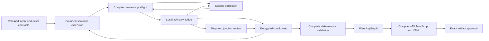

# Incremental TaskPlan construction

Fresh sessions extend one semantic TaskPlan from available producers toward
consumers. Each bounded draft passes deterministic semantic validation and a local
advisory review before acceptance. A simple workflow can finish in one draft.
There is no new executable representation or alternate engine.

## Durable boundaries

`PlanningSession.Plan` holds accepted semantic work. Optional versioned
`Construction` metadata records its frontier, candidate, checkpoint manifests,
requirement associations, review evidence and correction progress. These records
are non-executable and use the existing encrypted session, tenant, optimistic
revision and leases. Storage format 10 remains unchanged.

Extensions reuse task, value, group, choice and output contracts and append only
to issued open scopes. Apply candidates atomically to a clone. Compiler semantic
preflight remains the authority for types, contracts, ownership, references,
provenance, assertions, permissions and dependencies. Partial validation does not
lower a graph or suppress arbitrary final-validation errors.

Control inputs must be valid when a scope opens. Future work remains an obligation,
never a placeholder or dangling reference. Unfinished containers cannot supply
results, presence, ordering dependencies or callable group interfaces outside
their boundary. Child tasks may consume available values in their lexical scope.
Closing conditional branches requires compatible exports; parallel siblings
connect through enclosing exports.

Prompts contain the retained objective, applicable original requirements and
answers, a bounded frontier, selected exact contracts and imported interfaces.
Original evidence is retrieved by identity in bounded requests. The entire plan,
history and catalog stay in storage. Admission measures the complete serialized
request including its schema; indispensable evidence is never silently truncated.

## Review, correction and finalization

Every candidate requires local review before acceptance. Intermediate reviews
inspect multi-fragment closures, joins and every four accepted drafts, coalescing
overlapping triggers. Locations and evidence must resolve to supplied originals.
Invalid reports leave candidates unaccepted. Valid uncertainty stays unverified;
Judge findings are neither authorization nor deterministic proof.

Corrections share the existing call, token, cost and time journal and require a
replacement review. Repeated candidates, exhausted allowances or an unprovable
preservation boundary stop construction. Earlier changes invalidate dependents
through data/order edges, captures, exports, control ownership, group calls,
contracts and cleanup. Independent fragments and accepted intent remain unchanged;
invalidated originals remain evidence.
Invalidation events append the reason, before/after hashes, original tasks and
scope ordering. Rebuilt tasks retain their lexical scope, normal/cleanup phase
and relative position among independent tasks. A second invalidation cannot
overwrite an unresolved rebuild.

Finalization requires closed scopes/dependencies and explicit requirement statuses.
Full TaskPlan validation, PlanningGraph checks, confirmation guards, compiler v15
and runtime validation remain unchanged. There is no final whole-workflow LLM
Judge. Compilation does not prove content accuracy or successful effects.

## Captured capacity

Select `construction_preset: large` on a new `workflow.plan`, or
`constructionPreset: "large"` in a Designer start API request. Host setting
`TypedWorkflowPlanning.ConstructionPreset` controls the creation default.

| Limit | Ordinary | Large |
| --- | ---: | ---: |
| Model calls | 12 | 384 |
| Cumulative corrections | 4 | 64 |
| Recursive tasks per draft | 8 | 8 |
| Corrections per draft | 3 | 3 |
| Accepted checkpoints | 128 | 128 |
| Total generated nodes | 300 | 5,000 |
| Nodes per workflow | 300 | 5,000 |
| Generated workflows | 100 | 1,024 |

Host overrides are `LargeMaxModelCalls`, `LargeMaxReplanAttempts`,
`LargeMaxStepsTotal`, `LargeMaxStepsPerWorkflow` and `LargeMaxWorkflows`.
Effective limits are captured before dispatch. Recovery intersects saved call and
token allowances with current host ceilings; changed graph policy requires renewed
validation and review. Monetary and active-time limits remain captured in the
session. Large sessions are not accidentally capped by ordinary call settings.
No recovery operation silently increases captured limits.

The host retains 15,000,000 cumulative tokens and five hours of active time.
Construction uses the configured input ceiling (32,000 by default) and captured
phase output reservations of 8,192 for drafts/corrections and 2,048 for Judges,
bounded by generation settings. Eight tasks do not prove that variable-sized
content fits; oversized requests/responses fail explicitly.
`DraftOutputTokens` and `ReviewOutputTokens` configure those captured host
reservations. Authored `workflow.plan` generators use `draft_output_tokens` and
`review_output_tokens`; neither option raises the aggregate output ceiling.

Before a new draft or correction dispatch, admission checks its ceiling together
with every required review against the existing call, token and monetary ledgers,
including parent budgets. Durable model journals expose their owned budget through
the provider-neutral construction admission interface; ordinary runtimes use the
execution context's budget. Currency estimates use the existing validated exchange
quotes. This check consumes no calls, tokens, money or receipts, and does not pin a
new exchange quote. It is not a reservation: each actual dispatch still requires
normal admission and durable accounting. Unknown pricing fails closed when a
financial limit is configured.

Nullable `PlanningPolicy.MaxStepsPerWorkflow` and `MaxWorkflows` retain historical
300/100 behavior when absent. `MaxStepsTotal` controls total graph size. Inherited
host policy remains authoritative over authored limits. Planning capacity never
enlarges execution steps, depth, loops, sandbox or parallelism allowances. Large
tests use broad graphs with shallow scopes.

## Compatibility and isolated evaluation

Fresh creation captures construction behavior. Historical sessions retain issued
schemas, compiler profiles, identities, approvals, receipts and cumulative usage.
Their required compatibility paths cannot be selected by new sessions. Legacy
Judge options do not disable local review. Pending calls resume the exact saved
request and consume a saved receipt once; uncertain completion blocks replay.

`workflow.plan` atomically retains a versioned creation checkpoint alongside each
new encrypted authored definition, outside authored options. An interruption before
the first session write recovers those exact construction limits and compiler
profiles. Historical definitions without that marker retain their original path;
new caller defaults cannot migrate them or replenish their allowances.

An explicitly delegated benchmark reviewer uses trusted host authority and
artifact-bound evidence. It records delegated provenance, never fabricated human
review. Production entrypoints cannot enable that authority or import its
approval. Runtime confirmations cover one exact in-scope invocation, never blanket
permission. Independent business oracles remain separate from review and authority.

Campaigns retain their encrypted ledger, uncertain reservations and identities.
Budget extensions append authorization history. Frozen cohorts retain source,
contract, settings and oracle hashes, including failures. Reports distinguish
compilation, declared coverage, business success, uncertainty, physical calls,
tokens, elapsed time and cost.
