# Incremental TaskPlan construction

Fresh construction-version-2 sessions capture presentation revision 3 and extend one semantic TaskPlan from available producers
toward consumers. They index original intent once, select one immediate business
substep, discover its capabilities and generate only its fragment. Each bounded
draft passes deterministic semantic validation and a local advisory review before
acceptance. A simple workflow can finish in one draft after intent and substep
selection. There is no new executable representation or alternate engine.

```mermaid
flowchart LR
  Intent[Indexed original intent] --> Select[Select immediate business substep]
  Select --> Discover[Substep capability discovery and exact contract views]
  Select -->|Known local contract| Draft
  Discover --> Draft[Bounded semantic extension]
  Draft --> Validate[Compiler semantic preflight]
  Validate --> Review[Local advisory Judge]
  Validate --> Repair[Scoped correction]
  Review --> Repair
  Repair --> Validate
  Review --> Checkpoint[Encrypted checkpoint]
  Review --> Junction[Required junction review]
  Junction --> Checkpoint
  Checkpoint --> Select
  Checkpoint --> Final[Complete deterministic validation]
  Final --> Graph[PlanningGraph]
  Graph --> YAML[Compiler v15 JavaScript and YAML]
  YAML --> Approval[Exact artifact approval]
```

## Durable boundaries

`PlanningSession.Plan` holds accepted semantic work. Optional versioned
`Construction` metadata records its frontier, candidate, checkpoint manifests,
requirement associations, review evidence and correction progress. Version 2 also
retains source coverage, the current substep, tentative commitment bindings,
selected contract views, requirement closure and issued-request measurements. These records
are non-executable and use the existing encrypted session, tenant, optimistic
revision and leases. Storage format 10 remains unchanged.

Extensions reuse task, value, group, choice and output contracts and append only
to issued open scopes. Fresh selection schemas offer exactly the displayed open
scope page, with existing pagination for omitted scopes; a replacement keeps its
fixed scope. Historical issued requests remain exact. Apply candidates atomically to a clone. Compiler semantic
preflight remains the authority for types, contracts, ownership, references,
provenance, assertions, permissions and dependencies. Partial validation does not
lower a graph or suppress arbitrary final-validation errors.

Control inputs must be valid when a scope opens. Future work remains an obligation,
never a placeholder or dangling reference. Unfinished containers cannot supply
results, presence, ordering dependencies or callable group interfaces outside
their boundary. Child tasks may consume available values in their lexical scope.
Closing conditional branches requires compatible exports; parallel siblings
connect through enclosing exports.

Intent indexing processes stable original request and answer pages without
discarding source text. Page boundaries bound the bytes after both JSON escaping
layers and preserve Unicode characters. Compact presentation prefers
natural text boundaries and links unavoidable continuations; a severed obligation
cannot become independently complete on either page. Classification retains exact
verbatim clauses and identifies interface-bearing passages. Standalone interface
declarations may be separate clauses; an action and its adjacent composition/result
constraints remain one requirement even when they declare a public result.
Interface marking does not split that obligation. Revision 3 treats these marks
as provisional: extraction receives bounded surrounding originals and exact source
links, including earlier naming/type constraints. Within the same intent phase it
can produce typed declarations, explicitly identify spans with no public interface,
retrieve missing evidence or clarify material ambiguity. File-content and effect
requirements remain obligations even when they declare no public return value.
Bare empty arrays do not establish declaration coverage, and missing type context
does not justify inventing `any`. Pending dispositions or evidence block generation
and completion; typed interfaces are committed only after the extraction resolves.
Prose classification carries no recursive type/default grammar. Shared type
definitions and semantic validation remain authoritative; unreachable grammar is
removed from presentation. Historical revision-2 grouping, required directions and
issued requests retain their captured behavior.
Caller-input extraction uses one declaration shape with a required nullable
`default`: JSON null means no default, while `{"kind":"null"}` is an explicit
literal null. Recursive literals and semantic default checks are unchanged; public
outputs still omit default grammar. Extraction includes every distinct declared caller input and public
output in the supplied passages. A string has one schema shape: nullable `enum`
means unrestricted when null, or exactly the explicitly declared alternatives
when present. An empty string is a real value, never an absence placeholder.
These source and presentation corrections do not establish the hidden cause of
a provider's reasoning-only exhaustion.

## Substeps, contracts and scoped schemas

Selection identifies the next business action, original requirements and scope using caller/scope
inputs or accepted outputs. Revision 3 leaves `kind` null for capability-dependent
work. Existing discovery binds the implementation only after exact contract
inspection; scope, requirements and closure authority stay fixed. Supported local
computation, closed reusable calls and structural work can proceed directly to a
narrow draft. Resolving an unset kind is normal navigation; changing the selected
business action uses existing correction accounting. Technical setup, handles and result fields come from
inspected contracts, not assumed APIs. A demonstrated missing producer precedes its
consumer; a chain requiring unbuilt producers is not one immediate substep. The complete
original requirement stays attached and open across its contributing fragments.
Bounded prerequisite notes name needs and their original/contract evidence, never
future task IDs or independent executable states. Missing prerequisites leave the
original requirement open; available results come from the accepted TaskPlan and
its compiler-validated interfaces. Selection and drafting
share the value-task capability boundary: declared bindings and computations do
not provide string formatting, concatenation or URL encoding.
Cleanup, exports and closure use the same substep mechanism. Public workflow
outputs remain distinct from internal task/group results and local exports.
All unprocessed pages and unresolved requirements block completion.

Context includes the relevant original clauses and global constraints, exact
interfaces and bounded navigation links. Versioned addresses bind task objectives,
ports, scopes, requirements and source pages to their content. Advancing a cursor
does not satisfy a requirement. Accepted source coverage and reviewed checkpoints
can establish progress even when the TaskPlan hash is unchanged; diagnostics,
attempt counts and budgets cannot. Historical rejection identities remain enforced.
Fresh selection keeps bounded original objective prefixes and exact call/operation
identities so accepted work remains recognizable. Generation and scoped reviews
reuse task-evidence navigation for imported producers and up to four recent accepted
siblings in the selected scope, within the existing eight-item bound. Normal and
cleanup placement remain explicit; omitted work has counts and retrieval links.
These hints neither prove duplicated behavior nor grant edit authority. Findings
about exact bindings require the original task evidence. Unrelated scopes and
candidate tasks do not become accepted siblings; historical issued requests stay exact.
Selection reserves `groupId` for the immediate reusable call; other kinds use null.
Fresh loop guidance distinguishes finite execution capacity from original business
requirements. The TaskPlan default does not require rejecting another supported
capacity: explicit size conflicts still need correction, and unspecified capacity
remains unverified. Deterministic and runtime iteration limits are unchanged.
Fresh requirement evidence pages keep up to eight adjacent clauses from one
original source page together within the existing escaped-text bound. Whole
requirements retain their exact text, source identities and separate completion
statuses; an oversized indivisible requirement still faces complete-request
admission. Fresh selection uses that same bounded page at the earliest unresolved
requirement, omitting closed clauses; drafting and Judges receive only the selected
requirements. Historical singleton pages and issued requests are unchanged.

Discovery queries the selected substep, never the global objective. Cached
inspections stay retrievable without becoming mandatory context. Concise operation
and provider directories retain exact identities, effects and retrieval addresses.
The model chooses relevant providers and operations. Revision 3 lets the host
follow the selected provider's cursors within the existing four-read batch bound,
reuse cached pages and contracts, and checkpoint completed reads before continuing.
The received metadata action, remaining reads and exact cursor queue are retained
before traversal; recovery finishes that action without another model call or
correction charge. A follow-up that cannot fit its captured ceiling stops explicitly.
Unavailable, inconsistent or cyclic continuations stop traversal. Catalog metadata
reads retain their existing recovery contract; this does not claim exactly-once
provider reads or change paid-call and execution uncertainty handling.
Names locate candidates; exact descriptions and necessary continuations establish
their behavior. Uninspected candidates do not establish a missing capability.
Conflicting tentative assumptions use existing reselection within fixed scope,
requirements and correction allowances. Finding a suitable operation does not
require inspecting unrelated or later workflow actions.
A consumed navigation page does not invalidate an operation's identity. Fresh
provider views use `canRequestPage` for listing pagination, independently of the
source's unavailability reason; exhausting a listing preserves its discovered operations.
Provider source/cursor pairs come from the issued schema; evidence-page addresses are not
provider cursors. Copy issued addresses unchanged: an operation-page hash binds
that exact page and offset. Use supplied evidence directly; empty, exhausted or
repeated metadata pages do not create progress. The bounded first operation page
remains visible beside later evidence unless that exact page is already supplied;
only identities and retrieval links recur, not original prose or contract schemas.

Original MCP contracts remain unchanged in encrypted storage and authoritative
for validation. Descriptor and schema presentations share the existing projection
logic: exact subtrees, necessary parent and required-sibling constraints, coupled
alternatives, required descendants and referenced definitions remain intact.
Nested child-directory links allow precise retrieval without loading a huge parent.
Omitted optional descendants have exact retrieval addresses. An optional contract
argument may still be necessary to fulfill the business request and must be
retrieved before binding. Mandatory closures for selected operations are assembled
by the host with the same projection and prospective-admission checks. No unused
capacity is filled with unrelated contracts.

Under the captured phase policy, an evidence response may request one to eight
coherent addresses. Explicitly requested original views remain available within
the current decision. The host resolves the union on a clone and checks the complete
prospective follow-up, including its expanded binding grammar, against the hard
ceiling before accepting evidence. Provider discovery preserves those originals
while removing obsolete action directories; changing the candidate clears its
stale views, retaining hash-bound read history. Existing phase/substep transitions
clear presentation context. Oversized separable batches receive a
bounded diagnostic; indispensable indivisible closures fail explicitly. Successful
individual addresses and batch identities are retained, so regrouping old evidence
is not progress. Original description rereads require the exact issued knowledge
authority after genuinely new allowed operation identities or versions; a cursor
change is insufficient. Fresh correction context includes unresolved candidate
findings and current rejected-action diagnostics, so a failed retrieval receives
actionable feedback. Successful retrieval clears only its resolved evidence
diagnostics after atomic admission, preserving candidate findings and historical
failure records. Historical issued batch schemas and
reread rules remain exact.

Intent, selection, discovery and evidence actions contain no TaskPlan grammar.
Fresh generation builds directly from shared definitions for the selected task
kind and operations, retaining only reachable definitions and available actions.
Container openings create empty children for later substeps. Scope closure and
completion are offered only when the frontier and requirement statuses permit
those claims. Full semantic validation remains authoritative.

Selected imports guide context for ordinary unaccepted drafts under the fresh
phase policy. Compiler preflight derives the exact accessible bindings actually
used at each consumer, including predicates, cleanup and exports. Judges receive
those exact typed interfaces without widening field access. Selected scope and
requirements, accepted fragments and explicit revision paths remain binding.
Historical strict selected-import behavior is unchanged.

Requested root-scope evidence also contains the exact declared caller inputs.
Declarations establish the public interface even when the current fragment reads
no operands; they do not grant access inside isolated groups. A necessary producer
may be reviewed before its consumer or public export has been constructed.

Reusable groups are isolated: their bodies use declared parameters, not caller
captures. Calls select a closed group and receive its immutable hash, parameter
and output interface, including defaults; the body remains separately retrievable.
Open groups are constructible but not callable. Sequence/control scopes may use
legal ancestor captures. Open scope interfaces expose existing declarations for
construction without making their outputs consumable outside the container.

Scope exports are added without rewriting accepted exports. Closure review sees
the applied candidate's exports and compiler-derived types. Fresh ordinary reviews that add
no exports and claim no scope, requirement or plan closure present unchanged
accepted export names and bindings with a versioned exact evidence link, while
keeping all actual imported types inline. This avoids repeating unused accepted
object schemas; explicit evidence retrieval and closure reviews retain the exact
types and normal complete-request admission. Foreach body exports
become ordered arrays on the enclosing task, preserving duplicates and nested
arrays. `maxItems` is a capacity guard, distinct from `maxConcurrency`; neither
permits silently truncated successful results. Finite capacity with unspecified
business cardinality remains unverified, rather than permission to expand runtime
limits. A transform's named output references consume that field's declared type.

Already issued requests and review contexts retain exact bytes and hashes.
Historical version-1 construction keeps its original whole-contract admission;
new presentation rules never reinterpret its requests or receipts.

## Review, correction and finalization

Fresh compact drafts capture a transient candidate-failure identity version
before dispatch. Rejection identities include the accepted baseline, candidate
plan, open and closing scopes, completion claims and tentative commitments,
using canonical sets. A reviewed intermediate checkpoint followed by genuine
scope closure can therefore progress even when its final TaskPlan text matches
an earlier rejected candidate. Repeating the same semantic state still stops.
Historical bare plan-hash rejections remain enforced; already issued drafts,
repairs and Judges retain their captured comparison behavior. This optional
source-generated recovery metadata does not enter artifact or approval hashes.

Every candidate requires local review before acceptance. Intermediate reviews
inspect multi-fragment closures, joins and every four accepted drafts, coalescing
overlapping triggers. Locations and evidence must resolve to supplied originals.
Invalid reports leave candidates unaccepted. Valid uncertainty stays unverified;
Judge findings are neither authorization nor deterministic proof.
Compact reviews include bounded host facts identifying scope openings, closures
and completion claims. An intentionally empty opening is assessed as an opening;
closing a scope or requirement still requires its complete work and exports.
Cleanup can be a later substep in an open scope if its exact target and ownership
remain available after partial failure. Required creation-time capture is assessed
immediately; missing cleanup is assessed at scope or requirement closure. A
success-only result cannot supply cleanup required after failure. This distinction
does not change contract constraints, execution authority or finalization checks.
For presentation versions 2 and 3, scoped loop review guidance distinguishes
`maxItems`, which rejects excess input before iteration, from `maxConcurrency`,
which bounds workers. Neither implies sampled or truncated successful output.
Conflicts with explicit required sizes remain findings; when the original size
is unspecified, finite supported capacity remains uncertain rather than granting
authority to increase runtime limits.
Fresh Judges receive bounded choices of existing object-level JSON Pointers for
findings and evidence. Candidate tasks/exports and applicable requirements are
valid finding locations; imported interfaces, supplied contract evidence and
original clauses can ground evidence. Navigation links cannot ground a finding
until their original content is supplied. Pointer escaping and exact context
lookup remain authoritative; malformed reports stop acceptance. Public root
outputs and local exports are reviewed in their respective scopes.

Each Judge response selects one action. A completed review returns a findings
array (empty when no grounded finding exists) and null evidence requests. An
evidence action returns non-empty evidence requests and null findings. Both
fields null, or both arrays, remain inconclusive; an uncertainty statement alone
does not select an action. Already issued requests retain their original prompt,
schema and identity during recovery.

Corrections share the existing call, token, cost and time journal and require a
replacement review. A missing committed producer requires bounded replacement
of the tentative extension; an output-only typed patch cannot add that producer.
This routing never replaces an issued request or expands explicit edit authority.
Repeated candidates, exhausted allowances or an unprovable
preservation boundary stop construction. Earlier changes invalidate dependents
through data/order edges, captures, exports, control ownership, group calls,
contracts and cleanup. Independent fragments and accepted intent remain unchanged;
invalidated originals remain evidence.
Invalidation events append the reason, before/after hashes, original tasks and
scope ordering. Rebuilt tasks retain their lexical scope, normal/cleanup phase
and relative position among independent tasks. A second invalidation cannot
overwrite an unresolved rebuild.

Finalization requires closed scopes/dependencies and explicit requirement statuses.
Full TaskPlan validation, PlanningGraph checks, confirmation guards, compiler v15
and runtime validation remain unchanged. There is no final whole-workflow LLM
Judge. Compilation does not prove content accuracy or successful effects.

Version 2 separates requirement contribution from closure. A fragment may make
progress without satisfying a whole requirement. An explicit closure identifies
the exact original clause and relevant checkpoint evidence for scoped review;
coincident fragment/closure reviews are coalesced. New operation/result commitments
remain tentative with the candidate and append atomically when it is accepted.
Rejecting a candidate does not freeze its tentative operation choice. Previously
accepted commitments remain immutable. Closing a requirement records reviewed
declared coverage, never proof of prose completeness or successful execution.
The checkpoint retains which requirements the scoped review explicitly closed;
ordinary contribution checkpoints do not establish closure. A selected closure
may review an outstanding requirement without changing the TaskPlan or closing
its scope. It must close a previously unresolved obligation; repeating an already
closed requirement does not count as progress. A diagnosed tentative
step may request reselection within its original scope and requirement identities,
retaining rejected evidence and correction accounting. This cannot expand explicit
typed revision paths or change accepted fragments.
The same scope may then close with no requirement-closure claim, leaving the
original obligation open for later consumers or composition. Repeating the draft
does not withdraw a selected claim.
Where the draft schema offers rollback, its description explains the existing
host-computed dependency invalidation and required concrete reason. Accepted
requirements and permissions remain unchanged; a live candidate must first be
finished or abandoned before that action becomes available.
A tentative reselection archives the rejected decision and preserves scope and
requirement authority. Under the fresh phase policy, possible correction capacity
is checked before dispatch and the issued accounting mode is saved with the
pending request. Actual correction/reselection attempts are charged once when the
known response and transition are checkpointed. Fully validated evidence-only
responses consume calls, tokens and money but no correction. Invalid evidence
returned during a correction still consumes that attempt. Historical precharged
requests retain their charges; uncertainty is never refunded or replayed.

## Captured capacity

Select `construction_preset: large` on a new `workflow.plan`, or
`constructionPreset: "large"` in a Designer start API request. Host setting
`TypedWorkflowPlanning.ConstructionPreset` controls the creation default.

| Limit | Ordinary | Large |
| --- | ---: | ---: |
| Model calls | 64 | 384 |
| Cumulative corrections | 4 | 64 |
| Recursive tasks per draft | 8 | 8 |
| Corrections per draft | 3 | 3 |
| Accepted checkpoints | 128 | 128 |
| Total generated nodes | 300 | 5,000 |
| Nodes per workflow | 300 | 5,000 |
| Generated workflows | 100 | 1,024 |

Host overrides are `LargeMaxModelCalls`, `LargeMaxReplanAttempts`,
`LargeMaxStepsTotal`, `LargeMaxStepsPerWorkflow` and `LargeMaxWorkflows`.
Effective limits are captured before dispatch. Recovery intersects saved call and
token allowances with current host ceilings; changed graph policy requires renewed
validation and review. Monetary and active-time limits remain captured in the
session. Large sessions are not accidentally capped by ordinary call settings.
No recovery operation silently increases captured limits.

The host retains 15,000,000 cumulative tokens and five hours of active time.
Fresh sessions capture optional `construction_limits.phasePolicy` (version 1),
resolved by `PlanningConstructionPhasePolicies` across planner, host, HTTP journal
and benchmark. Its absence preserves historical semantics and hard ceilings.

| Phase family | Input target | Hard input ceiling | Initial output reservation |
| --- | ---: | ---: | ---: |
| Intent, selection, discovery | 3,000 | 6,000 | 8,192 |
| Generation, correction | 8,000 | 16,000 | 8,192 |
| Local and intermediate Judge | 4,000 | 8,000 | 2,048 |

Input limits cover the complete serialized request, including response schema and
envelope. Targets guide presentation and reporting: exceeding a target neither
fails admission nor requires another call. Hard ceilings and stricter explicit
host/request limits remain binding. Ordinary and large presets share these phase
settings; the latter changes only its captured call and graph capacity.

The phase policy captures reasoning and output reservations as well. Initial
reasoning is medium. Separately frozen experiments may use supported low reasoning
for navigation, or larger output reservations after verified exhaustion, subject
to explicit aggregate host caps. No session changes settings after dispatch; there
is no automatic escalation or unchanged failed-request retry. Reasoning consumes
the output allowance and is reported separately from visible output, consistent
with the [official reasoning documentation](https://developers.openai.com/api/docs/guides/reasoning?api-mode=chat). Deployment-declared support remains required for every experiment.

Each constructed request, including a locally rejected request, retains its phase,
request and response-schema hashes and component measurements. Substep, accepted
baseline hash and selected contract identities/versions are recorded when applicable. Component UTF-8 byte counts reconcile with
the exact complete serialized Core `LLMRequest`. The versioned conservative input estimate
includes envelope overhead; component estimates are not billed usage. Provider
input, output and reasoning tokens remain whole-call measurements, with Judge as
a phase dimension. Reports expose safe identities and sizes, not private intent,
contracts or receipts. Transient presentation and measurement metadata never
participate in artifact identity; captured construction version/settings do.

Before selection or discovery as well as generation/correction dispatch, admission
checks unavoidable downstream generation and reviews against the existing call, token and monetary ledgers,
including parent budgets. Durable model journals expose their owned budget through
the provider-neutral construction admission interface; ordinary runtimes use the
execution context's budget. Currency estimates use the existing validated exchange
quotes. This check consumes no calls, tokens, money or receipts, and does not pin a
new exchange quote. It is not a reservation: each actual dispatch still requires
normal admission and durable accounting. Unknown pricing fails closed when a
financial limit is configured.

Nullable `PlanningPolicy.MaxStepsPerWorkflow` and `MaxWorkflows` retain historical
300/100 behavior when absent. `MaxStepsTotal` controls total graph size. Inherited
host policy remains authoritative over authored limits. Planning capacity never
enlarges execution steps, depth, loops, sandbox or parallelism allowances. Large
tests use broad graphs with shallow scopes.

## Compatibility and isolated evaluation

Fresh interface instructions retain absent-default versus explicit-null and
unrestricted-string versus exhaustive-enum semantics after schema annotations
are compacted. File-content obligations do not imply public outputs; an explicit
public file-path declaration still requires a typed interface.

Fresh creation captures presentation revision 3 in the existing setting. Its
nullable implementation choices, prerequisite notes and extraction dispositions
are source-generated non-executable metadata; construction version 2 and storage
format 10 remain unchanged. Historical revision-2 sessions retain their original
selection/discovery/extraction behavior. Historical sessions retain issued
schemas, compiler profiles, identities, approvals, receipts and cumulative usage.
Their required compatibility paths cannot be selected by new sessions. Legacy
Judge options do not disable local review. Pending calls resume the exact saved
request and consume a saved receipt once; uncertain completion blocks replay.

`workflow.plan` atomically retains a versioned creation checkpoint alongside each
new encrypted authored definition, outside authored options. An interruption before
the first session write recovers those exact construction limits and compiler
profiles. Historical definitions without that marker retain their original path;
new caller defaults cannot migrate them or replenish their allowances.

An explicitly delegated benchmark reviewer uses trusted host authority and
artifact-bound evidence. It records delegated provenance, never fabricated human
review. Production entrypoints cannot enable that authority or import its
approval. Runtime confirmations cover one exact in-scope invocation, never blanket
permission. Independent business oracles remain separate from review and authority.

Campaigns retain their encrypted ledger, uncertain reservations and identities.
Budget extensions append authorization history. Frozen cohorts retain source,
contract, settings and oracle hashes, including failures. Reports distinguish
compilation, declared coverage, business success, uncertainty, physical calls,
tokens, elapsed time and cost.
