# Incremental TaskPlan construction

Fresh construction-version-2 sessions capture presentation revision 11 and extend one semantic TaskPlan from available producers
toward consumers. They index original intent once, select one immediate business
substep, discover its capabilities and generate only its fragment. Each bounded
draft passes deterministic semantic validation and a local advisory review before
acceptance. A simple workflow can finish in one draft after intent and substep
selection. There is no new executable representation or alternate engine.

```mermaid
flowchart LR
  Intent[Indexed original intent] --> Select[Select immediate business substep]
  Select --> Discover[Substep capability discovery and exact contract views]
  Select -->|Known local or inspected operation contract| Draft
  Discover --> Draft[Bounded semantic extension]
  Draft --> Validate[Compiler semantic preflight]
  Validate --> Review[Local advisory Judge]
  Validate --> Repair[Scoped correction]
  Review --> Repair
  Repair --> Validate
  Review --> Checkpoint[Encrypted checkpoint]
  Validate -->|Junction trigger: combined local and intermediate coverage| Review
  Checkpoint -->|Exact reviewed prerequisite binding| Draft
  Checkpoint --> Select
  Checkpoint --> Final[Complete deterministic validation]
  Final --> Graph[PlanningGraph]
  Graph --> YAML[Compiler v15 JavaScript and YAML]
  YAML --> Approval[Exact artifact approval]
```

During discovery, selected producer outputs are provisional navigation bindings. Their compiler-resolved nullable interfaces, exact accepted arguments, full original operation and top-level port descriptions, and bound-input schema constraints remain visible. Nested schema annotations and constraints remain exact through retrieval and the full draft/review closures. Automatic selected-output schema closures may be deferred through the exact existing schema/page links; explicitly retrieved originals remain intact. Draft and scoped review still include the complete selected original closures for actual consumers. Discovery grants no task, permission, or acceptance authority.

## Window-specific review evidence (presentation revision 11)

Each proposed source window derives its caller declarations from that window's
exact indexed sources before schema construction and complete-request measurement.
The fragment's requirement associations do not select the window's evidence.
Relevant ancestor controls include exact collection expressions, conditions,
iteration limits and scope identities, with original task retrieval addresses;
child bodies remain separate. Root declaration evidence grants no access inside
an isolated group. Compiler-resolved consumed interfaces remain authoritative.

Packing measures these projections for every trial window. A clean window still
cannot close a requirement without complete valid coverage. Fresh revision 11
inherits revision 10's continuation and conservation safeguards; versions 2–10
retain their original presentation behavior and issued requests.

On a rejected multi-address evidence batch, revision 11 prepares and admits the
complete single-address control before making recovery available. Optional task
and companion-operation navigation may move behind its exact links when needed;
original clauses, explicit evidence, consumed interfaces and contract closures do
not. The original report and detailed rejection remain in the candidate journal.
An unsendable mandatory review/control stops immediately. Admission and recovery
neither commit rejected evidence nor grant another correction or reassessment.

## Useful local evidence and independent transitions (presentation revision 10)

Fresh selection, drafting and scoped review share explicit structural semantics:
a TaskPlan group declares a named reusable body with isolated inputs and exports;
a call invokes that closed group. An inline control body is not a callable group,
including when compilation creates an internal workflow for that body. Objectives
and labels cannot supply missing structure. An empty necessary container remains
valid partial work; closure evaluates its actual contributing tasks and bindings
against the original obligations. This adds no keyword-based validator or oracle
change, and closing a boundary does not establish business fulfillment.
Presentations 2–9 and already issued requests retain their original guidance.

After existing public-output and closed-boundary subjects, a unique new
result-producing task in the actual executable delta can provide the subject for
an original clause. Its owned scopes and dependencies must be eligible. The normal
Judge still examines the whole original and may acknowledge broad applicability.
Bounded host reasons distinguish an absent subject, an unsupported conservation
context and received broad acknowledgment; no quota or extra classification call
is introduced.

A separate conservation class permits deterministic contributions following an
exact sequential root prefix of opaque operation/inference tasks. The prefix's
arguments, upstream context, complete contracts, permissions, ordering and cleanup
remain exact. Deterministic inputs and guards cannot consume opaque outputs.
Conditional, nested or concurrent opaque work and unknown interactions remain
ineligible. This proves conserved conditional behavior, not successful execution or
external-effect independence. New interactions, global constraints and closure
claims retain review through the existing coverage union.

An established export or local closure may advance while another consumer waits
only when the projected clone preserves that consumer's scope, exact dependencies,
imports, contracts and original evidence. A closure cannot close its boundary or
an ancestor. Root completion retains all global gates. A resumed business child
may prospectively bind its exact result to its immediate waiting ParentId in its
normal draft and review. Acceptance completes the child and permits parent
resumption; neither business obligation is discharged as navigation.

Fresh v10 resumption preserves the consumer's original four-note bound. Its typed
prerequisite remains in the existing continuation, alongside the exact selected
binding, rather than becoming a fifth note on the restored step. Retention,
discovery presentation and draft navigation share those exact evidence addresses.
This does not establish business completion; the consumer still needs its normal
validation and review. Historical resumption reconstruction is unchanged.

New v10 Judge evidence arrays describe same-batch coalescing in their issued
schema. After raw schema validation, identical addresses are retrieved once in
first-occurrence order. The original receipt, eight-entry wire bound, atomic
follow-up admission and successful-read repeat checks are preserved. Unmarked
issued schemas keep their prior handling; retrieval grants no review coverage.

Fresh v10 review guidance also explains how the current whole-clause window
assesses full completion claims. An obligation assigned to another window alone
does not require rereading it; a specific dependency or coupled constraint still
does. A clean window grants no completion, and the shared verifier requires all
outstanding coverage. The same guidance applies to the single report follow-up.
Historical guidance and saved issued requests remain unchanged. This addresses
an instruction ambiguity, not proof that every cross-window request is needless;
complete-request admission and mandatory coverage remain enforced.

Proofs, claims and transitions remain in existing journals. Candidate changes,
stale authorities and relevant invalidations require renewed review. One validated
transition is applied per advance before recomputing. Presentations 2–9 keep their
captured behavior and exact request/receipt recovery. No runtime contract, storage
format, Judge action protocol or financial/session ceiling changes accompany v10.

Newly issued v10 response schemas capture Unicode code-point string-length
validation in a standard `$comment` annotation. Response parsing reads that exact
issued annotation, including after recovery. Supplementary characters count once
for JSON Schema `minLength`/`maxLength`; byte and token admission stay separate.
Unmarked issued requests, including earlier v10 requests, retain their original
UTF-16 counting. Runtime contract validation and public APIs are unchanged. This
corrects a received Judge report falsely rejected at 256 code points/257 UTF-16
units; it grants no extra follow-up, evidence or correction allowance.

## Verified incremental coverage and advancement (presentation revision 9)

Review coverage is a union of fresh propositions and retained propositions whose
current applicability is verified. A proposition binds a complete original unit,
exact structural subject, claim kind (local behavior, interaction, global constraint
or completion), required review purposes, and its original request/receipt/checkpoint.
The host issues its identity. In the existing Judge call, the findings branch
acknowledges subject-bounded or broad applicability after examining the whole original.
A declaration or selected requirement association does not prove locality; empty
findings do not establish independence. Mixed and uncertain sources remain broad.

The host separately verifies conservation of the subject's dependencies: executable
values/objectives, upstream producers, inputs/defaults, groups, captures, exports,
control/order, iteration, failure/cleanup context, originals, complete contracts and
permissions. Supported classes include deterministic value computations, recursively
eligible executed groups and closed executable scopes. Unknown inference, operations
or shared external effects require broader review. New consumers and calls receive
interaction review even when a stable producer proposition remains applicable.
New closure claims require completion review; global and negative constraints retain
their applicable coverage. Unresolved defects remain blocking.

Reuse rows reference original receipts and current proofs; they never copy a clean
verdict under another candidate hash. One verifier governs window preparation,
remaining-review admission, acceptance, closure and approval. Only outstanding
obligations are packed into whole-clause windows, without increasing ceilings or
follow-up allowances. Every new fragment receives business review. Invalid or stale
proof restores required coverage and cannot reduce admission headroom speculatively.

The coordinator recovers pending requests and finishes candidate work before deriving
established transitions. Ordinary drafts/reviews may retain exact boundary exports,
local closure authority and consumer associations, including explicitly superseded
prerequisite-only descendants. These refer to existing work, not future tasks.
A child fragment can establish a parent closure while unrelated requirements remain
open; an exact parent export can be materialized without another selection/draft;
a reviewed ancestor association can resume without list reordering. ParentId,
original obligations, dependencies and effects still constrain ordering. Missing or
ambiguous authority returns to the specific semantic decision.

The optional draft/checkpoint `boundaryTransitions` field contains at most four
exact existing-boundary claims, one per scope. Each carries its original requirement
IDs, exact exports and an explicit `closeScope` assertion that no further work
belongs in that boundary. Scope parents determine child-before-parent order; list
order grants no scheduling authority. The host validates the combined projection,
then applies one eligible boundary extension and reviews its new interaction before
considering another retained claim. Root exports are permitted; root completion and
requirement closure retain their separate gates. An ancestor `continuationBinding`
names every bypassed prerequisite-only descendant in `dischargedContinuationIds`;
their records and ParentId links remain intact. These optional metadata fields are
omitted from historical state. Neither a missing conservation proof nor a compatible type
grants automatic transition authority. For unknown or external behavior, the shared
proof can instead require exact equality of the entire projected plan, open scopes,
original contracts and authority. This permits the reviewed transition only; it
establishes no independence or reusable local business proposition. A change to that
projected state restores semantic selection unless a deterministic conservation proof applies.

Each transition is clone-validated, reviewed where it introduces interaction or
completion claims, and checkpointed before continuing. Changed claims invalidate
review identity even without an executable-plan change. Relevant-state identities
prevent repeated unsuccessful application. Root closure retains complete original
coverage, public-output, cleanup and descendant requirements.

These changes are captured only for fresh revision-9 sessions. Revisions 2–8 keep
their captured future behavior; pending responses use their issued schemas. Metadata
is optional and non-executable. TaskPlan, storage format 10, compiler v15, execution
permissions and physical-attempt accounting are unchanged.

## Verified transitions (presentation revision 8)

The existing coordinator resolves established transitions before semantic selection:
resume the current reviewed consumer, resolve its selected cached contract, follow
eligible description continuations, or prepare one proven leaf closure. Request and
checkpoint journals identify the reason and supporting identities; a fallback
selection identifies the unresolved decision. This is derived navigation, not a
second plan or authority store.

Fresh continuation reviews prospectively capture applicability evidence in their
existing hashed review basis. An older exact association may resume after reviewed,
disjoint additions only when removing permitted new root literal values or unused
group definitions reconstructs the exact original accepted plan. Existing upstream
arguments, groups, control, exports, ordering and literals therefore cannot drift.
Sources, claims, permissions and complete original contracts must still match.
Unproven interactions, effects, revisions and missing proof retain semantic selection;
historical records do not acquire reconstructed authority. New consumer work still
passes ordinary preflight and scoped review.

Proven host closure can carry more than four original requirement IDs. The model's
selection bound remains four; host closure preserves all IDs and its stronger
reviewed-completion conditions, source windows and admission limits. Structural
closure creates no fabricated model receipt or execution approval.

After new provider knowledge permits an explicit original-description reread, the
same batch may restore eligible exact continuation pages. Knowledge-bound read and
failure identities remain authoritative; unchanged knowledge is not progress. The
eight-address cap, whole-page admission, exact links and atomic recovery remain.

Retained producer facts keep their original checkpoint and review provenance. They
do not become clean windows for a new candidate: new composition, bindings, effects
and completion claims retain every required original window. Presentation can share
identical embedded schema metadata under its exact contract, never across requests
or by dropping mandatory constraints. Existing Judge grammar and settings remain.

Revision 11 drafting/correction can also share byte-identical description, output
directory and artifact metadata when a consumed producer uses the same selected
operation's exact ID, version and complete contract hash. Its
`sharedContractMetadata` names only the shared fields and the selected operation's
request-local `detailsPointer`. Arguments, selected schema closures and original
coordinates remain with the producer; standalone retrieval stays complete.
Different fields or identities remain separate. This is display-only factoring,
not a TaskValue reference or a substitute for mandatory evidence admission.

Authoring requests also share byte-identical checkpoint navigation within the chosen
original-requirement view. The first complete row stays inline; subsequent associations
retain their sequence, original evidence address and an exact JSON Pointer to that row.
Choose the original view and evidence enums before this display-only reduction, so it
cannot change fallback selection or retrieval authority. Different rows remain separate,
and the original context, saved requests and Judge windows are unchanged.

## Accepted work and mechanical continuation (presentation revision 7)

The decision view joins original obligations to their accepted contributions, available
typed producers, suspended consumers and legal closures. It is derived from existing
state, not another persisted plan. Contributions and type compatibility do not prove
business fulfillment. A proven defect in accepted work still needs authorized scoped
revision; operation names establish neither redundancy nor permission to duplicate effects.

A prerequisite draft can propose `continuationBinding`: the current suspended consumer
and its exact semantic `TaskValue`. The host validates the producing fragment, scope,
nullable interface and original contracts; the ordinary scoped Judge reviews its meaning.
The association participates in review and rejection identity, then is retained in the
accepted checkpoint's step. Only a current, uniquely reviewed association resumes the
consumer mechanically while that checkpoint's accepted plan remains current. Intervening
accepted changes return to explicit semantic selection, since producer bytes alone do
not establish unchanged upstream meaning. Explicit selection may also bind an older accepted producer;
its current content and original contract review must still match its owning checkpoint.
Revisions and rollback invalidate
affected bindings, and an interrupted resumption never selects or dispatches twice.

Selection may bind a bounded offered page of exact inspected operations. It shares
discovery's contract resolution and complete-draft admission; unknown capabilities keep
deferred discovery. Original-description retrieval follows exact continuation links
within the existing eight-address batch. Only complete admitted pages are retained;
remaining originals keep exact links and incomplete evidence cannot establish absence.

An explicit close selection records either requirement-only closure (`closeScopes:[]`)
or the current scope. Where no new tasks, exports or bindings are needed, the host
prepares the unchanged-plan candidate without a generation call. All normal validation,
source-window coverage and mandatory reviews still apply. Closure before selection
retains its stronger existing reviewed-completion conditions. No new review cache,
reassessment allowance, execution authority or compiler path is introduced.

## Exact decision context and source windows (presentation revision 6)

Selection, discovery and drafting display all exact original requirements when the
complete prepared request fits. Otherwise they keep selected and explicitly retrieved
requirements, all global clauses and the mandatory core/evidence, with an omitted
count and exact requirement-page links. Review coverage still includes every original,
independently of the selected step's associations. Consumed producer views
retain the producing task's arguments, original operation prose, complete compact
port identities and exact bound-input/selected-output schema closures, including
nullability, required siblings and references. Unconsumed producer directories keep
exact prose/schema links. These views neither choose a replacement port nor grant
completion, revision or execution authority; required context is never truncated.
When a consumed producer view already carries an exactly matching compact port
directory, its task-navigation row keeps the identity and links without repeating
that array. Full producer semantics and every address remain available. Embedded v6 selected schema views inherit only their exactly matching parent contract identity and one identical view-description string. Every selected schema, ancestor constraint and reference closure remains intact; standalone retrieved views and issued requests keep their original bytes.
Navigation's `objectiveTextComplete` describes the displayed text only. Actual
open-scope identities determine closure diagnostics; truncated descriptions never
reopen accepted work. Earlier presentation revisions keep their original field.

Mandatory scoped review partitions originals into whole-clause windows when the
complete prepared request would exceed its captured ceiling. Linked continuations
stay together, and each window reviews the same candidate and completion claims.
Existing review records bind the window set to the accepted baseline, candidate,
claims, sources, evidence and contracts. All windows must pass before acceptance,
automatic closure or artifact approval. Changed evidence or identities invalidate
coverage; old rows remain history. Each window contains only its assigned originals,
with exact retrieval links and host-enumerated evidence addresses. Assess those
clauses against the unchanged full candidate claims; a claim concerning an original
assigned to another window alone does not require that original here. Retrieve it
when a specific dependency or coupled constraint is needed to assess a current
clause. A clean window does not close a requirement, and the existing single
follow-up allowance is shared
across the candidate. Indivisible context and remaining review headroom must fit
before dispatch. Pending requests retain their exact issued window and schema.

An independently established defect in accepted work uses the existing explicit
`revise` command with current identity, `preserveRequirements` and exact editable
paths. Typed repair preserves independent work, requirements and accounting and
renews scoped review and approval. Rollback cannot change literals it promises to
reconstruct, and a compensating runtime effect cannot edit the accepted TaskPlan.
The revision view shows only authorized current tasks, labeled separately from new
extensions. Prior defect comparisons use their exact current identity and subpath;
retained original evidence and review witnesses remain unchanged.
Presentation revision 6 retains an existing host-requested repair diagnostic while
its exact authorized paths, baseline and unchanged candidate hashes still agree.
Intent/interface revalidation runs normally but cannot discharge that obligation.
The marker stays separate from compiler rejection history and clears after an
authorized changed patch; renewed scoped review remains mandatory. Missing markers
are not reconstructed, and already-issued requests retain their original routing.
These changes establish context and validation boundaries, not live convergence.

## Accepted-state progression (presentation revision 5)

Closed requirements stay closed until explicit revision or dependency invalidation.
Selection distinguishes requested public results from accepted bindings and local
exports. Once all requirements are closed, ordinary work and unbound task kinds
leave the selection grammar. The host may prepare one unchanged-plan boundary
closure when retained scoped reviews establish the obligations, original source
coverage is complete, and no prerequisite, repair, choice or rebuild is pending.
Compiler validation and mandatory business review still precede acceptance; final
public-output validation remains mandatory. An empty scope or a local scalar
export is not a completion proof.
Before business review, an ordinary partial revision-5 candidate cannot close a
requirement whose complete, current source disposition directly declares a required
public output missing from the merged root. The existing claim-reselection route
handles this diagnostic. Optional outputs and corroborating evidence alone do not
establish that link. Explicitly authorized revisions keep their existing partial
repair behavior; final output validation is unchanged.
Host-prepared boundaries capture the same scoped candidate identity as model drafts
before validation and persistence. Review, recovery and approval therefore compare
the same candidate and completion claims; historical retained candidates are unchanged.
Closure context retains original obligations associated with accepted owners,
descendants, consumers and exports. Unknown associations or a set larger than the
existing four-requirement step bound leave closure to explicit selection; they
never fall back to an unrelated first requirement.

Reselection explicitly abandons an unsuitable action or suspends its consumer for
an evidenced typed prerequisite. At most four active continuations retain the
current prerequisite chain. The accepted TaskPlan supplies results; an explicit
producer checkpoint and binding resume a retained consumer only after source,
contract, scope and typed-interface validation. No second scheduler or executable
reference language is introduced. Invalidation preserves independent continuations.
Drafts and scoped reviews retain that active model-authored prerequisite as navigation,
not an original obligation or permission. The consumer summary is bounded to 1,024
serialized UTF-8 bytes with its existing rejection link; the complete prerequisite
type remains mandatory context subject to normal request admission. Selection's
`canAttemptResume` signals eligibility to propose an exact binding, not a proven
type match or the intended semantic producer. Existing issued requests stay unchanged.

Fresh Judge schemas require one action and separate original-obligation and concrete
implementation citations. A known complete, bounded parsed report with an exact
contract inconsistency may use the existing single follow-up allowance; a mixed
report containing grounded adverse findings cannot erase them through that path.
The same allowance covers supported inconclusive reassessment, with no renewed
evidence loop, uncertain replay or correction charge. Historical responses are
interpreted from their issued schemas. Overlapping local/intermediate triggers use
one broader frozen context with explicit coverage. Checkpoint acceptance and artifact
approval both verify that retained coverage, candidate and completion claims; one
successful combined review does not require a second receipt. A narrower review cannot be
reused retrospectively.
Finite-capacity semantics apply throughout revision-5 review, including later
consumers and closures. This relocates the existing loop guidance once per request;
it does not infer required cardinalities or automatically dismiss adverse findings.
Current arguments and effects must still satisfy applicable original constraints when
their requirements or scopes remain open. Fresh revision-5 guidance asks drafting and
review to match the consumed value's meaning and entity identity to the argument
contract, separately from compiler-checked type compatibility. Unobserved execution
does not defer a demonstrable argument mismatch. This wording experiment adds no
validator, schema, correction authority or runtime behavior; live efficacy remains
unverified. Selection and review expose bounded exact
accepted-operation arguments and dependencies alongside existing navigation.
Complete fitting accepted-task originals use the existing evidence dictionary;
oversized originals remain explicitly retrievable. Directories alone remain
insufficient grounding, and equal arguments do not automatically establish an
unnecessary operation.
Accepted producer navigation retains original artifact kinds and business ports,
with exact contract identities and existing output-page and original-description links.
Fresh revision-5 consumers can retrieve the producer's normative prose and its continuations
without selecting another operation or treating a bare output type as its complete contract. Before selection,
the same description addresses require an exact accessible accepted producer, as output-page reads do. Bounded omissions
stay retrievable; reading an accessible producer's output schema does not add an
operation, select generation branches, or grant new field access. Literal or
same-type values still cannot manufacture artifact provenance.
Normal selection retains explicit prerequisite evidence, not every earlier inspection.
Producer prose omitted from the new context remains retrievable through the existing
progress checks; later port pages and nested schemas use the same bounded loader.
Fresh revision-5 discovery retains bounded cached operation choices for selected accepted producers and dependencies.
Exact original description links remain available; canonical operation pages and contract admission are unchanged.

Grounded rejections retain bounded original-context witnesses through their
replacement chain, including candidate-free reselection. Resumed consumers use
their own retained rejection history; accepted work ends the replacement chain,
so unrelated later selections do not inherit its findings. Candidate hashes
still establish novelty; they do not establish defect resolution. A correction
presents its relevant before/after bindings to the mandatory scoped Judge, retaining
executable objectives and literals. Historical edit-authority snapshots are evidence;
only the current repair contract grants edits. Repeated affected values without new relevant
support require a different authorized local strategy and then stop on non-progress.
All findings remain advisory; deterministic grounding is not semantic proof.
Version-5 correction context also retains historical technical rejection feedback
in the existing candidate review records. At most three observations fit within
6,144 serialized bytes, using the existing 1,024-byte whole-value snapshots.
Exact compiler value locations identify the rejected binding; unsupported locations
and oversized values remain explicitly unavailable. Baseline, source/contract and
target identities distinguish historical support from stale evidence. This feedback
survives the same replacement chain after a typed repair clears current diagnostics,
but creates no diagnosis, repair slot or Judge citation authority. It is omitted from
a technically valid candidate's business review. Original requests remain unchanged;
measurement accounts for this presentation under `construction_context`.
Rollback reconstructs every invalidated task, preserving its original effects,
literal arguments and other accepted commitments. It cannot withdraw an accepted
operation. Fresh rollback and rebuild context state that limit and expose bounded
whole original input lists with exact retrieval links when omitted. No deletion
authority is inferred from a rollback reason or from apparently repeated effects.
Before a replacement review, an active witness's exact accepted-task evidence may
be re-resolved into the existing evidence context. Baseline, source, full task,
scope, placement and supplied evidence hash must still match. The existing
three-finding and 1,024-byte snapshot bounds apply; unrelated, changed or oversized
evidence stays absent. Restored evidence is not new progress, repair authority or
a reinterpretation of a historical snapshot. Issued requests remain unchanged.

## Durable boundaries

`PlanningSession.Plan` holds accepted semantic work. Optional versioned
`Construction` metadata records its frontier, candidate, checkpoint manifests,
requirement associations, review evidence and correction progress. Version 2 also
retains source coverage, the current substep, tentative commitment bindings,
selected contract views, requirement closure and issued-request measurements. These records
are non-executable and use the existing encrypted session, tenant, optimistic
revision and leases. Storage format 10 remains unchanged.

Extensions reuse task, value, group, choice and output contracts and append only
to issued open scopes. Fresh selection schemas offer exactly the displayed open
scope page, with existing pagination for omitted scopes; a replacement keeps its
fixed scope. When the full accepted symbol table has no tasks, revision-5 selection
omits `output` and `present` imports, including inside field projections. Caller
inputs, choices and taskless closed-group calls remain available; existing reference
validation still applies. Revision-6 selection enumerates exact input names from complete
declarations for its offered scopes, including isolated reusable-group parameters.
This shared name set does not bypass scope validation or turn evidence addresses into bindings.
Historical issued requests remain exact. Apply candidates atomically to a clone. Compiler semantic
preflight remains the authority for types, contracts, ownership, references,
provenance, assertions, permissions and dependencies. Partial validation does not
lower a graph or suppress arbitrary final-validation errors.

Fresh revision-4 guidance appends ordinary sequential work to an appropriate
existing scope. New containers supply needed control, reuse, cleanup or export
boundaries; they do not replace a missing producer or defer the same action.
Author and Judge task navigation includes one bounded selected-scope owner and
its exact original links, separately from consumed producers and recent siblings.
This navigation establishes no finding, consumption or edit authority.
Revision-4 review contracts also retain the exact provider and method when declared;
these identify the selected capability without proving execution or expanding permissions.

Control inputs must be valid when a scope opens. Future work remains an obligation,
never a placeholder or dangling reference. Unfinished containers cannot supply
results, presence, ordering dependencies or callable group interfaces outside
their boundary. Child tasks may consume available values in their lexical scope.
Closing conditional branches requires compatible exports; parallel siblings
connect through enclosing exports.

Intent indexing processes stable original request and answer pages without
discarding source text. Page boundaries bound the bytes after both JSON escaping
layers and preserve Unicode characters. Compact presentation prefers
natural text boundaries and links unavoidable continuations; a severed obligation
cannot become independently complete on either page. Classification retains exact
verbatim clauses and identifies interface-bearing passages. Standalone interface
declarations may be separate clauses; an action and its adjacent composition/result
constraints remain one requirement even when they declare a public result.
Interface marking does not split that obligation. Revision 3 treats these marks
as provisional: extraction receives bounded surrounding originals and exact source
links, including earlier naming/type constraints. Fresh revision 5 fills unused slots in the existing three-page context with immediate containing-page neighbors, after opening, containing and latest-answer priorities; neighboring originals remain supporting evidence, not additional extraction candidates. Within the same intent phase it
can produce typed declarations, explicitly identify spans with no public interface,
retrieve missing evidence or clarify material ambiguity. Before extracting types,
it determines whether a source declares a caller input or a value returned to the
caller. Writing an artifact and specifying its contents do not themselves declare
that interface; an explicitly returned path or content still does. File-content
and effect requirements remain obligations even without a public return value.
Bare empty arrays do not establish declaration coverage, and missing type context
does not justify inventing `any`. Pending dispositions or evidence block generation
and completion; typed interfaces are committed only after the extraction resolves.
Prose classification carries no recursive type/default grammar. Shared type
definitions and semantic validation remain authoritative; unreachable grammar is
removed from presentation. Historical revision-2 grouping, required directions and
issued requests retain their captured behavior.
Interface-guidance consolidation is a separate fresh-v5 prompt experiment with unchanged schema, context and settings.
Current candidate sources determine the extraction's declaration set; surrounding
originals and accepted names provide support rather than extra candidates. A current
source may explicitly link an unchanged accepted interface. Fresh revision-5
coverage feedback distinguishes duplicate typed names, disposition names missing a
typed declaration, and typed names absent from current dispositions. Each category
retains at most four whole names within 384 serialized UTF-8 bytes, with total and
omitted counts. Ordinal uniqueness and exact set equality still decide acceptance;
historical diagnostics and all issued requests remain unchanged.
Caller-input extraction uses one declaration shape with a required nullable
`default`: JSON null means no default, while `{"kind":"null"}` is an explicit
literal null. Recursive literals and semantic default checks are unchanged; public
outputs still omit default grammar. Fresh revision-4 extraction failures retain the
compiler's default rejection while locating the exact default slot and reporting
bounded facts from the rejected declaration. These facts do not accept the declaration
or replace nested constraint validation; revision-3 feedback and issued requests remain unchanged.
Extraction includes every distinct declared caller input and public
output in the supplied passages. A string has one schema shape: nullable `enum`
means unrestricted when null, or exactly the explicitly declared alternatives
when present. An empty string is a real value, never an absence placeholder.
Revision-3 extraction requests compact JSON formatting outside string values;
original string contents, parsing and retained receipts remain unchanged.
These source and presentation corrections do not establish the hidden cause of
a provider's reasoning-only exhaustion.

## Substeps, contracts and scoped schemas

Selection identifies the next business action, original requirements and scope using caller/scope
inputs or accepted outputs. Revision 3 leaves `kind` null for capability-dependent
work. Discovery chooses a tentative implementation from offered original descriptions;
the host then resolves its exact contract and admits the required constraint closure
and complete draft grammar before accepting that binding. Fresh revision-5 guidance
states this ordering; historical guidance and issued requests remain exact. Scope,
requirements and closure authority stay fixed. Fresh revision-4
binding schemas couple operation identities to `operation`, a reusable target to
`call`, and neither field to other kinds. This reflects existing semantic checks;
revision-3 schemas and already issued requests retain their exact grammar. Supported local
computation, closed reusable calls and structural work can proceed directly to a
narrow draft. Resolving an unset kind is normal navigation; changing the selected
business action uses existing correction accounting. Technical setup, handles and result fields come from
inspected contracts, not assumed APIs. A demonstrated missing producer precedes its
consumer; a chain requiring unbuilt producers is not one immediate substep. The complete
original requirement stays attached and open across its contributing fragments.
Bounded prerequisite notes name needs and their original/contract evidence, never
future task IDs or independent executable states. Missing prerequisites leave the
original requirement open; available results come from the accepted TaskPlan and
its compiler-validated interfaces. Selection and drafting
share the value-task capability boundary: declared bindings and computations do
not provide string formatting, concatenation or URL encoding.
Container opening, child implementation and closure are separate immediate
substeps. Opening establishes control inputs and a boundary; it cannot consume
the future body result or claim its broader requirement complete. Export a
container result only after its child scopes close.
Cleanup, exports and closure use the same substep mechanism. Public workflow
outputs remain distinct from internal task/group results and local exports.
All unprocessed pages and unresolved requirements block completion.
Fresh revision-6 discovery omits `close` only when the fixed step permits no
scope closure, export or pending requirement closure under the existing rules.
Nested exports, input-only requirement closure and retained issued schemas stay valid.

Revision-3 drafting retains the current scope's exact evidence address. Structural
openings also retain a bounded page of closed reusable interfaces; other drafts
receive only the exact interface-directory link. Interface and task evidence pages
retain exact continuations. Evidence
responses select addresses present in host-owned navigation, including nested MCP
directories and required-sibling omission links. Fresh revision-6 accepted-producer rows also link the existing input-schema directory.
Selection and consumers may retrieve exact omitted-input branches and defaults from
accessible accepted producers without selecting those operations or applying defaults.
Nested pages and exact ancestor/reference closure use the same admission and recovery
rules. Original contract data is never
interpreted as navigation authority. Selection and reselection reuse these exact
choices for displayed originals, interfaces and retained rejection records. Each
response has one non-null action; retrieving evidence does not also select a step.
Selection separates call targets from other
kinds and restricts prerequisite citations to original clauses or retained exact
contracts; task/group inspection links do not establish prerequisite authority.
A prerequisite may cite another requirement's declaration without claiming its
coverage or closure. Its exact retrieval link remains available after selection.
Historical presentations and already issued requests keep their original schemas.
Fresh revision-5 selection offers the existing interface-directory address from
later pages so earlier caller declarations and accepted producers remain retrievable;
already supplied pages stay in evidence and cannot be reread as progress. Forward
selection navigation skips those retained pages without changing the requested-page cursor.

Fresh Judges receive the same TaskPlan meaning as drafting, with authoring-only
actions omitted. Revision 4 supplies exact requirement closure identities; requirement
associations and operation commitments remain contributions, not claims that every
associated obligation is complete. Revision-5 review distinguishes an operation's
descriptive purpose from its contract-defined current effects: purpose adds no
contract behavior or requirement to perform future work now. Transform objectives
remain executable instructions; original constraints on current effects still apply.
Scope closure and plan completion retain their
existing full-obligation checks. They assess closure, bindings and collection behavior through
findings or evidence requests; they cannot reselect a step, add exports or expand
generation grammar. Draft instructions and historical issued reviews remain exact.

Context includes the relevant original clauses and global constraints, exact
interfaces and bounded navigation links. Versioned addresses bind task objectives,
ports, scopes, requirements and source pages to their content. Advancing a cursor
does not satisfy a requirement. Accepted source coverage and reviewed checkpoints
can establish progress even when the TaskPlan hash is unchanged; diagnostics,
attempt counts and budgets cannot. Historical rejection identities remain enforced.
Fresh selection keeps bounded original objective prefixes and exact call/operation
identities so accepted work remains recognizable. Generation and scoped reviews
reuse task-evidence navigation for imported producers and up to four recent accepted
siblings in the selected scope, within the existing eight-item bound. Normal and
cleanup placement remain explicit; omitted work has counts and retrieval links.
These hints neither prove duplicated behavior nor grant edit authority. Findings
about exact bindings require the original task evidence. Unrelated scopes and
candidate tasks do not become accepted siblings; historical issued requests stay exact.
Selection reserves `groupId` for the immediate reusable call; other kinds use null.
Fresh loop guidance distinguishes finite execution capacity from original business
requirements. An undeclared input length does not demand unlimited execution;
all admitted items must be preserved, and excess input fails without truncated
success. Explicit required capacities or known required item counts can still
establish a conflict. Unspecified capacity remains unverified, without inventing
a caller restriction. Deterministic and runtime iteration limits are unchanged.
Fresh requirement evidence pages keep up to eight adjacent clauses from one
original source page together within the existing escaped-text bound. Whole
requirements retain their exact text, source identities and separate completion
statuses; an oversized indivisible requirement still faces complete-request
admission. Fresh selection uses that same bounded page at the earliest unresolved
requirement, omitting closed clauses. Fresh revision-5 drafting, discovery and Judges
retain selected requirements plus bounded navigation to other exact original clauses.
Requested pages retain their continuation links; reading an unselected obligation
does not associate work, close it or expand correction authority. Historical singleton
pages and issued requests are unchanged.

Discovery queries the selected substep, never the global objective. Fresh revision-4
automatic operation directories use only metadata pages for that exact substep query;
registered runtime capabilities retain their existing handling. Cached inspections
and original contracts stay retrievable without becoming automatic context. Historical
content-addressed directories are reconstructed only for an exact address authorized
by the saved issued schema and matching the retained canonical page hash. Concise operation
and provider directories retain exact identities, effects and retrieval addresses.
The model chooses relevant providers and operations. Fresh revision-3 decisions
show up to eight compact provider choices without inspecting them. Requested
provider evidence retains its exact two-item pages; continuations and schema
choices preserve the original source/cursor pairs. Inspected operations are a
subset, not proof that other providers lack the needed capability. Revision 3 lets the host
follow the selected provider's cursors within the existing four-read batch bound,
reuse cached pages and contracts, and checkpoint completed reads before continuing.
The received metadata action, remaining reads and exact cursor queue are retained
before traversal; recovery finishes that action without another model call or
correction charge. A follow-up that cannot fit its captured ceiling stops explicitly.
Unavailable, inconsistent or cyclic continuations stop traversal. Catalog metadata
reads retain their existing recovery contract; this does not claim exactly-once
provider reads or change paid-call and execution uncertainty handling.
Names locate candidates; exact descriptions and necessary continuations establish
their behavior. Uninspected candidates do not establish a missing capability.
Conflicting tentative assumptions use existing reselection within fixed scope,
requirements and correction allowances. Finding a suitable operation does not
require inspecting unrelated or later workflow actions.
A consumed navigation page does not invalidate an operation's identity. Fresh
provider views use `canRequestPage` for listing pagination, independently of the
source's unavailability reason; exhausting a listing preserves its discovered operations.
Provider source/cursor pairs come from the issued schema; evidence-page addresses are not
provider cursors. Copy issued addresses unchanged: an operation-page hash binds
that exact page and offset. Use supplied evidence directly; empty, exhausted or
repeated metadata pages do not create progress. The bounded first operation page
remains visible beside later evidence unless that exact page is already supplied;
only identities and retrieval links recur, not original prose or contract schemas.

Original MCP contracts remain unchanged in encrypted storage and authoritative
for validation. Descriptor and schema presentations share the existing projection
logic: exact subtrees, necessary parent and required-sibling constraints, coupled
alternatives, required descendants and referenced definitions remain intact.
Nested child-directory links allow precise retrieval without loading a huge parent.
Omitted optional descendants have exact retrieval addresses. An optional contract
argument may still be necessary to fulfill the business request and must be
retrieved before binding. Mandatory closures for selected operations are assembled
by the host with the same projection and prospective-admission checks. No unused
capacity is filled with unrelated contracts.

Under the captured phase policy, an evidence response may request one to eight
coherent addresses. Explicitly requested original views remain stored within
the current decision. Fresh revision-3 discovery presents an older description
as exact identity/hash/page metadata and a retrieval link only when strict new
operation knowledge makes its existing reread guard eligible. Current-knowledge
descriptions, prerequisite citations and schema views remain complete; a permitted
reread restores the full original view without resetting consumption history.
Revision 4 omits only redundant version fields already encoded in verified
description addresses, including rows of retained content-addressed operation
directories. Text, identities, effects, continuations and canonical stored pages
remain unchanged; directory hashes still identify the complete original pages.
Fresh discovery schemas offer batches of up to eight unseen issued addresses or
one eligible description reread; mixed or regrouped rereads are not offered.
Exact prerequisite citations remain navigable across original requirements.
Revision 6 carries the existing bounded suspended-consumer view from selection into
deferred discovery: the exact typed need, evidence link and accepted-producer status
remain visible. Its rejected-step and checkpoint links use the existing read-only
evidence grammar and admission. This navigation neither satisfies the prerequisite
nor resumes or accepts work; presentation revisions 2–5 retain their prior context.
Partial descriptions retain continuations and cannot establish missing behavior.
The host resolves evidence on a clone and checks the complete
prospective follow-up, including its expanded binding grammar, against the hard
ceiling before accepting evidence. Provider discovery preserves those originals
while removing obsolete action directories; changing the candidate clears its
stale views, retaining hash-bound read history. Existing phase/substep transitions
clear presentation context. Oversized separable batches receive a
bounded diagnostic; indispensable indivisible closures fail explicitly.
Revision-4 requests offer one exact discovery or draft evidence address while an earlier
batch-size diagnosis remains unresolved; successful admission restores the ordinary
batch choices. This avoids repeated batch-size guesses without changing the ceiling
or omitting required constraints. Successful
individual addresses and batch identities are retained, so regrouping old evidence
is not progress. Original description rereads require the exact issued knowledge
authority after genuinely new allowed operation identities or versions; a cursor
change is insufficient. Fresh correction context includes unresolved candidate
findings and current rejected-action diagnostics, so a failed retrieval receives
actionable feedback. Successful retrieval clears only its resolved evidence
diagnostics after atomic admission, preserving candidate findings and historical
failure records. Historical issued batch schemas and
reread rules remain exact.

Intent, selection, discovery and evidence actions contain no TaskPlan grammar.
Fresh generation builds directly from shared definitions for the selected task
kind and operations, retaining only reachable definitions and available actions.
Revision-4 author guidance mirrors the existing progress check: add work, an export
or a scope closure, or close a still-open host-issued requirement in a close step.
Requirement IDs alone are annotations. Cleanup-only work and reviewed
requirement-only closure remain valid; schemas and the deterministic guard are unchanged.
Container openings create empty children for later substeps. Scope closure and
completion are offered only when the frontier and requirement statuses permit
those claims. Full semantic validation remains authoritative.

Selected imports guide context for ordinary unaccepted drafts under the fresh
phase policy. Compiler preflight derives the exact accessible bindings actually
used at each consumer, including predicates, cleanup and exports. Judges receive
those exact typed interfaces without widening field access. Selected scope and
requirements, accepted fragments and explicit revision paths remain binding.
Historical strict selected-import behavior is unchanged.

Requested root-scope evidence also contains the exact declared caller inputs.
Declarations establish the public interface even when the current fragment reads
no operands; they do not grant access inside isolated groups. A necessary producer
may be reviewed before its consumer or public export has been constructed.
Revision-3 closure reviews expose the scope evidence address and a bounded caller
input directory independently of consumed operands, including before the first
checkpoint. Existing interface pages and exact input addresses retrieve full
declarations without routinely including unrelated schemas. Group reviews retain
their isolated parameter interface. Partial navigation alone cannot establish an
absent or incompatible declaration; the Judge must retrieve the relevant evidence.

Revision 4 supplies relevant caller declarations inline when their completed
extraction dispositions link exact original sources to the current requirement.
Full declarations share a bounded byte allowance; omitted constraints remain
available at exact input addresses. An unproven source association exposes only
the existing bounded directory, never an inferred declaration. These views remain
separate from actual consumed operands and isolated group parameters.

Reusable groups are isolated: their bodies use declared parameters, not caller
captures. Calls select a closed group and receive its immutable hash, parameter
and output interface, including defaults; the body remains separately retrievable.
Open groups are constructible but not callable. Sequence/control scopes may use
legal ancestor captures. Open scope interfaces expose existing declarations for
construction without making their outputs consumable outside the container.

Scope exports are added without rewriting accepted exports. An empty draft export
list preserves accepted declarations. Later tasks in the same scope can consume
ordinary task results without exports; exports carry values across the enclosing
task or group boundary. Fresh revision-4 author and Judge guidance states this
distinction without making open containers consumable. The selected `/root` scope's exports are
public outputs; nested scope exports are local. Judges assess the combined
accepted and candidate declarations. Closure review sees
the applied candidate's exports and compiler-derived types. Revision 6 also derives
the owning group's open state and outputs from that same validated candidate,
labelled `tentative_candidate`. Referenced producer groups remain
`accepted_declarations`; an open root does not reopen a closed reusable group.
Historical group summaries and issued requests retain their original presentation.
Fresh ordinary reviews that add
no exports and claim no scope, requirement or plan closure present unchanged
accepted export names and bindings with a versioned exact evidence link, while
keeping all actual imported types inline. This avoids repeating unused accepted
object schemas; explicit evidence retrieval and closure reviews retain the exact
types and normal complete-request admission. Foreach body exports
become ordered arrays on the enclosing task, preserving duplicates and nested
arrays. `maxItems` is a capacity guard, distinct from `maxConcurrency`; neither
permits silently truncated successful results. Finite capacity with unspecified
business cardinality remains unverified, rather than permission to expand runtime
limits. A transform's named output references consume that field's declared type.

Already issued requests and review contexts retain exact bytes and hashes.
Historical version-1 construction keeps its original whole-contract admission;
new presentation rules never reinterpret its requests or receipts.

## Review, correction and finalization

Fresh compact drafts capture a transient candidate-failure identity version
before dispatch. Rejection identities include the accepted baseline, candidate
plan, open and closing scopes, completion claims and tentative commitments,
using canonical sets. A reviewed intermediate checkpoint followed by genuine
scope closure can therefore progress even when its final TaskPlan text matches
an earlier rejected candidate. Repeating the same semantic state still stops.
Historical bare plan-hash rejections remain enforced; already issued drafts,
repairs and Judges retain their captured comparison behavior. This optional
source-generated recovery metadata does not enter artifact or approval hashes.

Every candidate requires local review before acceptance. Intermediate reviews
inspect multi-fragment closures, joins and every four accepted drafts, coalescing
overlapping triggers. Revision 4 presents compact facts from actual compiler
preflight, including declaration-only candidates with no imported operands.
Request construction shares the compiler result across exact bindings and scope
interfaces for the same plan/open-scope basis. Combined frontier queries exceeding
the unchanged compiler interface bound use separately bounded queries; no
indivisible interface is truncated. Unfinished interfaces, unresolved business
choices, full requirement coverage, final whole-plan validation, runtime behavior
and execution authority remain outside that proof. Locations and evidence must resolve to supplied originals.
Invalid reports leave candidates unaccepted. Valid uncertainty stays unverified;
Judge findings are neither authorization nor deterministic proof.
Compact reviews include bounded host facts identifying scope openings, closures
and completion claims. An intentionally empty opening is assessed as an opening;
closing a scope or requirement still requires its complete work and exports.
Cleanup can be a later substep in an open scope if its exact target and ownership
remain available after partial failure. Required creation-time capture is assessed
immediately; missing cleanup is assessed at scope or requirement closure. A
success-only result cannot supply cleanup required after failure. This distinction
does not change contract constraints, execution authority or finalization checks.
For presentation versions 2 and 3, scoped loop review guidance distinguishes
`maxItems`, which rejects excess input before iteration, from `maxConcurrency`,
which bounds workers. Neither implies sampled or truncated successful output.
Conflicts with explicit required sizes remain findings; when the original size
is unspecified, finite supported capacity remains uncertain rather than granting
authority to increase runtime limits.
Fresh Judges receive bounded choices of existing object-level JSON Pointers for
findings and evidence. Candidate tasks/exports and applicable requirements are
valid finding locations; imported interfaces, supplied contract evidence and
original clauses can ground evidence. Navigation links cannot ground a finding
until their original content is supplied. Pointer escaping and exact context
lookup remain authoritative; malformed reports stop acceptance. Public root
outputs and local exports are reviewed in their respective scopes.

Fresh revision-6 Judge instructions use one coherent block for business claims,
verified bindings, grounded citations and evidence boundaries. Shared task-kind,
source-window and report-follow-up guidance remains unchanged. This instruction
experiment changes no response schema, source coverage, model setting or original
contract context; historical guidance and issued requests remain byte-exact.
Smaller requests alone do not establish better reasoning or business acceptance.

Each Judge response selects one action. A completed review returns a findings
array; an evidence action requests exact missing support. Revision 4 additionally
allows an explicit `inconclusive` reason when business assessment is incomplete.
All other action fields are null. Residual execution uncertainty in a completed
review differs from an unfinished business review. A finding must cite an
applicable original obligation and concrete implementation evidence; navigation
or a preflight status alone cannot substantiate a correction.
For fresh revision 4, an oversized multi-address evidence batch retains its exact
admission diagnosis and narrows the next evidence action to one address. The
rejected batch stages no evidence or correction; successful evidence retrieval
clears the diagnosis. An oversized singleton stops with the measured size and
captured ceiling. Original constraints remain intact, and this evidence loop is
separate from inconclusive reassessment. Historical review feedback is unchanged.
The verified preflight identifies whether the selected scope is open separately
from the total open-boundary count. An open root or ancestor does not reopen
accepted child scopes; their exact implementation remains retrievable for review.
Fresh reports count an exact concrete finding location as its implementation
citation, so one original-obligation evidence pointer can suffice. The existing
grounding predicate and local correction boundary still apply. The issued schema
captures this with `evidence.minItems: 1`; retained revision-4 schemas with
`minItems: 2` keep their evidence-only grounding. Fresh explanations and per-finding
uncertainty are bounded to 512 and 256 characters respectively, without increasing
the captured review output reservation. Fresh requests carry the existing citation
guidance on the `evidence` field, once, rather than in the phase instructions. This
presentation change leaves the structural grammar, grounding checks and issued
historical requests unchanged; live benefit requires separate measurement.

A valid inconclusive response may receive one reassessment for the same semantic
candidate and completion claim, shared across local and intermediate review.
Only already relevant, omitted exact input declarations, export schemas or accepted
producers identified by verified consumed bindings and issued task addresses can
supply the additional support. Producer lookup excludes candidate-owned tasks,
already supplied concrete tasks and invalidated originals; it does not interpret
the report's prose or expand nested bodies. The host stages retrieval and admits the complete
follow-up plus required downstream review before saving it. The receipt, support
hashes and exact issued request remain durable; reassessment consumes calls and
usage without a correction charge. Missing new support, exhausted allowances,
malformed reports or another inconclusive result stop without a checkpoint or
edit authority. Reassessment cannot restart an evidence cycle. Historical
revision-3 response actions and all issued requests retain their exact prompts,
schemas, identities and recovery behavior.

Corrections share the existing call, token, cost and time journal and require a
replacement review. A missing committed producer requires bounded replacement
of the tentative extension; an output-only typed patch cannot add that producer.
This routing never replaces an issued request or expands explicit edit authority.
Repeated candidates, exhausted allowances or an unprovable
preservation boundary stop construction. Earlier changes invalidate dependents
through data/order edges, captures, exports, control ownership, group calls,
contracts and cleanup. Independent fragments and accepted intent remain unchanged;
invalidated originals remain evidence.
Invalidation events append the reason, before/after hashes, original tasks and
scope ordering. Rebuilt tasks retain their lexical scope, normal/cleanup phase
and relative position among independent tasks. A second invalidation cannot
overwrite an unresolved rebuild.

Finalization requires closed scopes/dependencies and explicit requirement statuses.
Full TaskPlan validation, PlanningGraph checks, confirmation guards, compiler v15
and runtime validation remain unchanged. There is no final whole-workflow LLM
Judge. Compilation does not prove content accuracy or successful effects.

Version 2 separates requirement contribution from closure. A fragment may make
progress without satisfying a whole requirement. An explicit closure identifies
the exact original clause and relevant checkpoint evidence for scoped review;
coincident fragment/closure reviews are coalesced. New operation/result commitments
remain tentative with the candidate and append atomically when it is accepted.
Fresh revision-5 draft schemas pair each selected operation with its own exact
declared result ports; public output names do not create producer ports. A null
result remains valid, and operations without outputs offer only that form.
Rejecting a candidate does not freeze its tentative operation choice. Previously
accepted commitments remain immutable. Closing a requirement records reviewed
declared coverage, never proof of prose completeness or successful execution.
The checkpoint retains which requirements the scoped review explicitly closed;
ordinary contribution checkpoints do not establish closure. A selected closure
may review an outstanding requirement without changing the TaskPlan or closing
its scope. It must close a previously unresolved obligation; repeating an already
closed requirement does not count as progress. A diagnosed tentative
step may request reselection within its original scope and requirement identities,
retaining rejected evidence and correction accounting. This cannot expand explicit
typed revision paths or change accepted fragments.
The same scope may then close with no requirement-closure claim, leaving the
original obligation open for later consumers or composition. Repeating the draft
does not withdraw a selected claim.
Where the draft schema offers rollback, its description explains the existing
host-computed dependency invalidation and required concrete reason. Accepted
requirements and permissions remain unchanged; a live candidate must first be
finished or abandoned before that action becomes available.
A tentative reselection archives the rejected decision and preserves scope and
requirement authority. Revision-4 guidance makes that handoff explicit: a demonstrated
missing producer becomes the next prerequisite substep before its consumer. Draft
commitments accompany an extension only; evidence retrieval stages no commitments
or other decision metadata. These instructions preserve the existing validators,
accounting and exact historical requests. Under the fresh phase policy, possible correction capacity
is checked before dispatch and the issued accounting mode is saved with the
pending request. Actual correction/reselection attempts are charged once when the
known response and transition are checkpointed. Fully validated evidence-only
responses consume calls, tokens and money but no correction. Invalid evidence
returned during a correction still consumes that attempt. Historical precharged
requests retain their charges; uncertainty is never refunded or replayed.
For fresh revision 4, an evidence-admission diagnosis alone does not turn an
ordinary draft into a repair. An oversized batch remains unaccepted and offers
one exact address next, even when correction capacity is exhausted. Existing
semantic findings remain blocking and retain their correction accounting. A
required singleton that cannot fit stops explicitly; no partial evidence,
ceiling increase or checkpoint is accepted. Pending requests retain their exact
purpose, schema and accounting mode.

## Captured capacity

Select `construction_preset: large` on a new `workflow.plan`, or
`constructionPreset: "large"` in a Designer start API request. Host setting
`TypedWorkflowPlanning.ConstructionPreset` controls the creation default.

| Limit | Ordinary | Large |
| --- | ---: | ---: |
| Model calls | 64 | 384 |
| Cumulative corrections | 4 | 64 |
| Recursive tasks per draft | 8 | 8 |
| Corrections per draft | 3 | 3 |
| Accepted checkpoints | 128 | 128 |
| Total generated nodes | 300 | 5,000 |
| Nodes per workflow | 300 | 5,000 |
| Generated workflows | 100 | 1,024 |

Host overrides are `LargeMaxModelCalls`, `LargeMaxReplanAttempts`,
`LargeMaxStepsTotal`, `LargeMaxStepsPerWorkflow` and `LargeMaxWorkflows`.
Effective limits are captured before dispatch. Recovery intersects saved call and
token allowances with current host ceilings; changed graph policy requires renewed
validation and review. Monetary and active-time limits remain captured in the
session. Large sessions are not accidentally capped by ordinary call settings.
No recovery operation silently increases captured limits.

The host retains 15,000,000 cumulative tokens and five hours of active time.
Fresh sessions capture optional `construction_limits.phasePolicy` (version 1),
resolved by `PlanningConstructionPhasePolicies` across planner, host, HTTP journal
and benchmark. Its absence preserves historical semantics and hard ceilings.

| Phase family | Input target | Hard input ceiling | Initial output reservation |
| --- | ---: | ---: | ---: |
| Intent, selection, discovery | 3,000 | 6,000 | 8,192 |
| Generation, correction | 8,000 | 16,000 | 8,192 |
| Local and intermediate Judge | 4,000 | 8,000 | 2,048 |

Input limits cover the complete serialized request, including response schema and
envelope. Targets guide presentation and reporting: exceeding a target neither
fails admission nor requires another call. Hard ceilings and stricter explicit
host/request limits remain binding. Ordinary and large presets share these phase
settings; the latter changes only its captured call and graph capacity.

The phase policy captures reasoning and output reservations as well. Initial
reasoning is medium. Separately frozen experiments may use supported low reasoning
for navigation, or larger output reservations after verified exhaustion, subject
to explicit aggregate host caps. No session changes settings after dispatch; there
is no automatic escalation or unchanged failed-request retry. Reasoning consumes
the output allowance and is reported separately from visible output, consistent
with the [official reasoning documentation](https://developers.openai.com/api/docs/guides/reasoning?api-mode=chat). Deployment-declared support remains required for every experiment.

Each constructed request, including a locally rejected request, retains its phase,
request and response-schema hashes and component measurements. Substep, accepted
baseline hash and selected contract identities/versions are recorded when applicable. Component UTF-8 byte counts reconcile with
the exact complete serialized Core `LLMRequest`. The versioned conservative input estimate
includes envelope overhead; component estimates are not billed usage. Provider
input, output and reasoning tokens remain whole-call measurements, with Judge as
a phase dimension. Reports expose safe identities and sizes, not private intent,
contracts or receipts. Transient presentation and measurement metadata never
participate in artifact identity; captured construction version/settings do.

Before selection or discovery as well as generation/correction dispatch, admission
checks unavoidable downstream generation and reviews against the existing call, token and monetary ledgers,
including parent budgets. Durable model journals expose their owned budget through
the provider-neutral construction admission interface; ordinary runtimes use the
execution context's budget. Currency estimates use the existing validated exchange
quotes. This check consumes no calls, tokens, money or receipts, and does not pin a
new exchange quote. It is not a reservation: each actual dispatch still requires
normal admission and durable accounting. Unknown pricing fails closed when a
financial limit is configured.

Fresh creation also captures optional `planning_transport_policy` version 1.
Synchronous tool-free generation may make at most three physical HTTP attempts
through the existing helper, after fully persisted 500/502/503/504 responses or a
temporary 429 with a recognized rate-limit code or valid `Retry-After`. Permanent
provider failures, uncertain outcomes and invalid model responses never trigger
this retry path. Each attempt consumes the same cumulative call allowance and
retains its conservative token/cost reservation until verified usage settles that
attempt. Failed reservations remain charged after a later success. The issued
request captures remaining mandatory review headroom, including an intermediate
review still required after a local Judge. Transport retries do not charge repairs.

The production request journals share encrypted attempt persistence through
Flow.Integrations. Fresh budget snapshots retain optional attempt identities for
idempotent reservation and settlement; historical snapshots omit them. Recovery
uses saved responses, request fingerprints and backoff, never a reconstructed
request. A missing outcome stops. Parsing an already saved success can settle
usage without another dispatch; it cannot replenish planning time. Absent transport
policy preserves historical request bytes and recovery.

The benchmark captures its fresh planning deadline from the planner allowance,
bounded by five hours and tighter host limits. Historical absent captures retain
30 minutes. Execution deadlines remain separate. A measured mandatory request can
justify a larger newly frozen phase ceiling, such as the diagnostic 18,000-token
draft ceiling; its original constraints and independent Judge admission remain
unchanged. Targets do not trigger additional model calls.

Nullable `PlanningPolicy.MaxStepsPerWorkflow` and `MaxWorkflows` retain historical
300/100 behavior when absent. `MaxStepsTotal` controls total graph size. Inherited
host policy remains authoritative over authored limits. Planning capacity never
enlarges execution steps, depth, loops, sandbox or parallelism allowances. Large
tests use broad graphs with shallow scopes.

## Compatibility and isolated evaluation

Fresh interface instructions retain absent-default versus explicit-null and
unrestricted-string versus exhaustive-enum semantics after schema annotations
are compacted. File-content obligations do not imply public outputs; an explicit
public file-path declaration still requires a typed interface.

Fresh creation captures presentation revision 9 in the existing setting. It
inherits compiler-grounded review context and explicit inconclusive reviews,
using existing candidate review records for grounded findings and repair witnesses.
Nullable implementation choices, prerequisite continuations and extraction
dispositions remain non-executable metadata; construction version 2
and storage format 10 are unchanged. Historical revisions 2 through 8 retain their
captured future-request behavior as well as already issued requests. Historical sessions retain issued
schemas, compiler profiles, identities, approvals, receipts and cumulative usage.
Their required compatibility paths cannot be selected by new sessions. Legacy
Judge options do not disable local review. Pending calls resume the exact saved
request and consume a saved receipt once; uncertain completion blocks replay.

`workflow.plan` atomically retains a versioned creation checkpoint alongside each
new encrypted authored definition, outside authored options. An interruption before
the first session write recovers those exact construction limits and compiler
profiles. Historical definitions without that marker retain their original path;
new caller defaults cannot migrate them or replenish their allowances.

An explicitly delegated benchmark reviewer uses trusted host authority and
artifact-bound evidence. It records delegated provenance, never fabricated human
review. Production entrypoints cannot enable that authority or import its
approval. Runtime confirmations cover one exact in-scope invocation, never blanket
permission. Independent business oracles remain separate from review and authority.

Campaigns retain their encrypted ledger, uncertain reservations and identities.
Budget extensions append authorization history. Frozen cohorts retain source,
contract, settings and oracle hashes, including failures. Reports distinguish
compilation, declared coverage, business success, uncertainty, physical calls,
tokens, elapsed time and cost.

Issued response schemas own prerequisite/reselection string bounds. Shared semantic validators check the action, scope and evidence but do not impose a second UTF-16 length limit after schema validation. This also applies when revalidating a retained consumer. Marked requests use Unicode code points; unmarked historical requests retain UTF-16 bounds, including old version-10 receipts.

For version 11, selection port directories and their evidence choices share the same displayed page. Omitted ports remain reachable through the original typed `port-page` continuation. Earlier versions retain their complete issued address domains. Port paging changes presentation only: selection still validates exact contracts and later consumers receive full mandatory closures.

Version 11 builds selection grammar from its displayed request-local page. Before omitting unrelated original rows, it tries deterministic reductions of optional navigation descriptions, ordered by measured complete-request byte savings and stable identity. Every omitted description keeps an exact original retrieval address. Active obligations, globals, explicit evidence, scopes and operation choices stay intact; exceeding a target alone triggers no reduction. A mandatory core that still exceeds the captured hard ceiling remains an ordinary admission failure.

When a version-11 review window exceeds admission, checkpoint contribution task directories use the existing task-navigation projection too. Each retains its exact `task:` retrieval link and checkpoint provenance. Original clauses, source versions, actual consumed interfaces, ancestor controls, contract closures, explicit evidence and coverage claims remain complete. Removing optional history descriptions supplies no new proof or acceptance authority.
